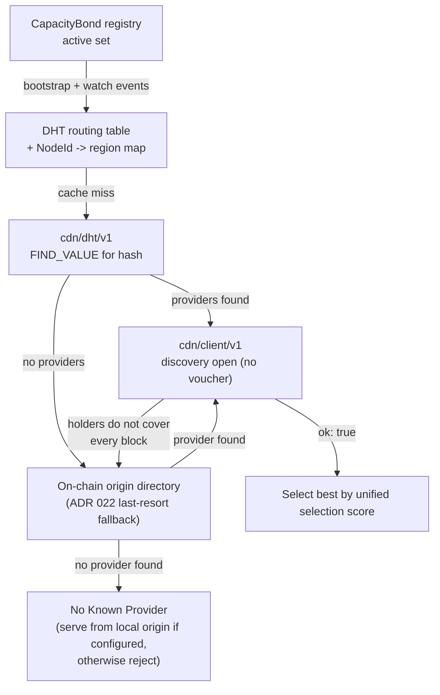

# ADR 001: Network Topology and Peer Mesh

**Date:** 2026-03-28
**Status:** Accepted

## Context

The CDN has two participant roles. **Nodes** (providers) cache and serve content close to clients — some have an origin backend (S3, NFS, local disk) making them the canonical source for specific content, others are pure caches. **Clients** consume content. No external origin URL exists; the network is fully self-contained.

Two questions are in scope:

1. How do nodes discover each other and learn what content each holds?
2. How does a node resolve a cache miss?

## Decision

All bonded nodes form a flat peer mesh with no fixed routing hierarchy. Node discovery is the on-chain `CapacityBond` registry active set; content discovery uses `cdn/dht/v1` (a lightweight Kademlia subset — see [ADR 022](022-content-discovery.md#adr-022--content-discovery-at-scale)), with the on-chain origin directory as the deterministic fallback when the DHT returns no providers, or when the holders that answer discovery opens do not cover every block of the blob:



### Node Discovery (Registry)

A node discovers its peers from the on-chain `CapacityBond` registry active set. The node reads the active set at startup. It keeps the set fresh by reading `getRegisteredNodes` again on a fixed interval, and early when a peer presents a `NodeId` that the set does not hold ([ADR 019 § Chain state reads](019-node-onboarding.md#chain-state-reads)). The same active set seeds the `cdn/dht/v1` routing table ([ADR 022 § Routing Table](022-content-discovery.md#routing-table)).

A node dials any peer by its iroh `NodeId`. The registry supplies each active peer's `NodeId` and its reachable transport addresses in the `NodeInfo.multiaddrs` field. A node sets those addresses at registration and updates them with `updateMultiaddrs`. Registration defaults them to the host's public addresses on `network.bind_port` ([ADR 019 § Phase 2](019-node-onboarding.md#phase-2--on-chain-setup)). When the field carries addresses, the dialer feeds them to iroh as direct-address hints. The node daemon keeps every registered node's addresses in an address lookup on its iroh endpoint, so each dial by bare `NodeId` gets them.

iroh also runs its built-in discovery. Each node publishes a signed pkarr record with its relay URL and its globally routable IP addresses. The record omits private, loopback, link-local, and shared (CGNAT) addresses. iroh updates the record when the node's address changes. A peer with no registry address, or with a stale one, is therefore still dialable directly by `NodeId`.

iroh races all paths to the peer. A peer with a reachable address connects directly, with no relay. The relay path stays as the fallback for a peer behind NAT. A self-attested address never gates a dial: it is one path among several, so a stale or wrong address loses the race but never fails the connection.

The active set is the sole membership source. A node checks it before it initiates a paid pull (see Content Discovery), and the `cdn/dht/v1` STORE path admits records only from an active-bonded `NodeId` ([ADR 022 § STORE Flow](022-content-discovery.md#store-flow-cache-event--dht-publish)). A `NodeDeregistered` or `NodeAutoEjected` event removes the peer from the local view in the same handler that updates the cached active set.

### Node Region Metadata

Each node declares a region — an ISO 3166-1 alpha-2 country code — on-chain as `regionHint` at `CapacityBond.registerNode` ([ADR 030](030-node-region-self-attestation.md#adr-030-node-region-self-attestation)). The `CapacityBond` registry refresh resolves the active set into a `NodeId → region` map alongside the routing table. Region byte-accounting and the [ADR 030](030-node-region-self-attestation.md#adr-030-node-region-self-attestation) RTT-vs-claim selection penalty read this map. The region is self-attested and accepted at face value; a pulling node applies a reputation penalty when observed latency contradicts the claimed region.

### Content Discovery (DHT + Discovery Open)

Content discovery uses `cdn/dht/v1` as the primary mechanism. The full iterative `FindValueRequest` flow, origin-directory fallback, and bootstrap behavior are specified in [ADR 022 § FIND_VALUE Flow (Cache Miss → DHT Lookup)](022-content-discovery.md#find_value-flow-cache-miss--dht-lookup). After the DHT lookup, the node sends a discovery open to each candidate: a `cdn/client/v1` stream that carries no voucher and does not set `pull_through` ([ADR 005 § Discovery opens](005-protocol.md#discovery-opens)). The signed answer confirms live availability, states the quote and proves the size before any paid pull. This ADR owns two pieces layered on top of that flow: the candidate cache and the open-response collection window.

#### Candidate cache

A short-lived LRU cache holds `hash → Vec<(NodeId, rate_per_mb, rtt)>` entries, TTL 30 seconds, max 1024 entries. Each provider in an entry also keeps the unsigned coverage and the proven size of its answer, so a cache-hit candidate can still be range-planned. Each hash entry retains at most 10 responses (top 10 by selection score). Approximate memory: 1,024 × 10 × ~100 bytes ≈ 1 MB. The cache keeps no signature: a structure that speeds up the next request does not hold the slashable statements of other nodes. On a cache miss the requester checks the candidate cache first; if a valid entry exists, it skips the DHT lookup and the discovery fan-out and goes straight to selection. Selection reads reputation live, not from the entry. On the ranged pull leg, an entry whose providers do not cover every block of the blob is not valid, and the requester runs a fresh DHT lookup and discovery round ([ADR 022 § FIND_VALUE Flow](022-content-discovery.md#find_value-flow-cache-miss--dht-lookup)). On a cache hit, the pull opens a stream on the selected provider. If that provider refuses, the requester tries the next-best cached provider; if all fail, it runs a fresh DHT lookup and discovery round.

**Candidate cache TTL is 30 seconds.** A stale entry is cheap. A hit skips only the DHT lookup and the discovery fan-out. The paid open re-verifies the quote, the proven size and the coverage before the requester pays a voucher, so a stale entry costs at most one open. The same TTL is the short suppression of a `(NodeId, hash)` pair after a shed, a timestamp refusal or a quote above the ceiling. So the positive and the negative view of a peer age on one clock.

**Negative candidate cache.** A second LRU cache holds `(NodeId, hash)` keys — NodeIds that answered a discovery open for a given hash with a signed `NotFound` that names no held block, or with `Declined` — with TTL 5 minutes and max 1024 entries. Before it opens a stream to a NodeId returned in a DHT FIND_VALUE response ([ADR 022 § FIND_VALUE Flow](022-content-discovery.md#find_value-flow-cache-miss--dht-lookup)), the requester consults the negative cache and drops any `(NodeId, hash)` pair present. This bounds the cost of false-STORE publishers at the receivers closest to a hash in keyspace: a publisher advertising a hash it does not hold is exposed at the discovery open by a single signed refusal, and that exposure is then sticky for 5 minutes against the affected requester. Without this cache, every subsequent cache miss for the same hash would open a stream on the lying publisher again, wasting round-trips and miss-latency budget.

An assigned origin is an origin that the origin directory or an origin attestation names for the content. An assigned origin that answers a discovery open with `NotFound` and no held block is not negative-cached. Such an origin can fill the blob from its backend for a request that sets `pull_through`. When no usable holder serves the span, the node opens these origins with `pull_through` set, as cold pull-through targets, nearest by path RTT first. The candidate cache never holds a cold target.

**Negative cache TTL is 5 minutes** — longer than the candidate cache (30 s) because false-STORE results are less time-sensitive than positive-availability snapshots, and shorter than the DHT record TTL (1h) so a publisher that genuinely acquires the blob during the negative window can re-establish reachability after one cache lifetime. The cache key is `(NodeId, hash)` only — the negative cache is purely a request-suppression structure.

#### Open response collection

After the DHT FIND_VALUE (per [ADR 022](022-content-discovery.md#find_value-flow-cache-miss--dht-lookup)), open the candidate set concurrently and collect answers as they arrive. Collection stops as soon as enough blob-holding candidates have answered to fill the failover budget (the pull tries at most three providers, so three viable answers end the round), and otherwise runs until the **2.5 s** open ceiling (`OPEN_CEILING`) elapses. Because the candidates are opened in parallel, this single ceiling bounds the whole collection phase rather than the sum of per-candidate waits. The early stop keeps a healthy round at the speed of its fastest good answers instead of the ceiling. The ceiling covers one open from start to finish: the wait for a free discovery slot on the connection, 1 s for the dial, 1 s for the exchange (`OPEN_TIMEOUT` each), and the 500 ms wait for a direct path. Each 1 s bound accommodates inter-continental RTTs (for example, London↔Sydney ~250–300 ms). Every open uses the node's shared connection to the upstream, so an upstream that the node already talks to costs no dial, and the exchange is one round trip. Candidates that have not answered by the time the round ends are dropped. A cold holder that is still on the relay arrives after the path wait, with its relay RTT ([ADR 005 § Negative](005-protocol.md#negative)). The ranged pull leg gathers by coverage instead of by count: it collects answers until the holders together cover the requested range ([ADR 039](039-multi-source-parallel-fetch.md#adr-039-multi-source-parallel-fetch-scheduling-on-cdnclientv1)).

A discovery open asks for the span that the pull needs: the whole blob for a buffered fill, or the pull's own range on the ranged pull leg. The open of the candidate that the node pulls from first becomes its first paid leg when the span and the pool match, so the node opens no second stream to that candidate. The node cancels every other open.

Store every holder answer in the candidate cache, then select the best provider using the unified [node selection algorithm](#node-selection-algorithm). Before opening `cdn/client/v1`, verify the selected `node_id` is still active in the registry active set; if not, skip to the next-best provider.

### Node Selection Algorithm

The unified selection score combines price, latency, and reputation into a single comparable value:

```
selection_score = rate_per_mb × rtt_ms × (1 / max(reputation, 0.1)²)
```

Lower is better. `rtt_ms` has a floor of 1 ms in the score. Without the floor, a sub-millisecond RTT makes the score 0 and removes price and reputation from the ranking. Reputation is clamped to a minimum of 0.1 to prevent division by zero ([ADR 008](008-reputation.md#adr-008-reputation-system) allows a floor of 0.0, but a node at 0.0 reputation is effectively unusable). The implementation additionally bounds the denominator *above* at 1.0 — a no-op for any reputation inside the [0.0, 1.0] domain this formula assumes, and a defensive guard against a producer that violates it buying an unearned bonus rather than a penalty. The `reputation²` term amplifies reputation: a node at 0.5 (neutral) is 4× more expensive in score terms than a node at 1.0 (perfect):

| Reputation | Score multiplier (vs. rep=1.0) |
| --- | --- |
| 1.0 | 1.0× |
| 0.8 | 1.56× |
| 0.5 | 4.0× |
| 0.3 | 11.1× |
| 0.1 | 100× |

For new nodes with the initial reputation of 0.5 ([ADR 008](008-reputation.md#adr-008-reputation-system)), the 4× multiplier means they must be ~4× cheaper or faster to compete with established nodes — a bootstrap barrier they clear by pricing or performing competitively until they accrue reputation.

**Inputs:** `rate_per_mb` comes from the signed `StreamResponse` of the discovery open, and `rtt_ms` is the path RTT of that open ([ADR 005 § Discovery opens](005-protocol.md#discovery-opens)). `reputation` is the pulling node's own local score for the peer from [ADR 008 § Local Score Calculation](008-reputation.md#local-score-calculation) (a never-interacted peer is treated as the neutral 0.5).

**Reputation is a graded weight, not a veto.** It enters selection only through the `1 / max(reputation, 0.1)²` term above, which caps the worst-case penalty at 100×. There is no pre-scoring minimum-reputation filter: a sufficiently cheap or close node can outrank a poorly-reputed one, and that is intended — [ADR 008](008-reputation.md#adr-008-reputation-system) treats the local score as a subjective preference signal, not admission control. Pool membership is decided by bonding and authorization, not by reputation.

#### Tie-breaking

(scores within 1% of each other): see [ADR 008, Tie-Breaking](008-reputation.md#tie-breaking).

This score ranks a node's upstream candidates on its cache-miss pull leg — the node-to-node FIND_VALUE → discovery open → select flow of Content Discovery above. The client path does not compute it: a client ranks candidates by path RTT, then by quote, then by coverage, and takes the price from the signed `StreamResponse` ([ADR 037 § Client selection policy](037-regional-proxy-warming.md#client-selection-policy-latency-driven-proxy-preference)). The simpler `rate_per_mb × rtt_ms` product is the price×latency component; the full selection algorithm adds reputation weighting as shown above.

### On-chain Registration

Node identity is the iroh `NodeId` (ed25519 public key). All bonded nodes register in `CapacityBond` — the on-chain contract holding `NodeId → (Ethereum address, multiaddrs, region, active flag)`. The contract surface (`NodeInfo` struct, `registerNode` with atomic NodeId↔Ethereum binding and ed25519 ownership proof, `updateMultiaddrs`, `deregisterNode`, `reclaimNodeId`, events, gas costs) is specified in [ADR 003 § Node Registry](003-payments.md#node-registry). Nodes and clients build their peer view from this registry on startup (see [ADR 019](019-node-onboarding.md#adr-019-node-onboarding-and-bootstrapping-flow) and [ADR 012 § Bootstrap Procedure](012-client.md#bootstrap-procedure)).

## Consequences

### Positive

- No external infrastructure is reachable — origin-backed nodes completely hide their backends, so no client or node can bypass the payment layer via a direct storage URL
- All nodes share the same discovery and transport protocols. The cache-only role remains permissionless — any staked operator may pull cached blobs from authorized origins and re-serve them while it holds a live origin attestation for each ([ADR 022 § Origin Attestation](022-content-discovery.md#origin-attestation)). The origin role is DAO-governed: governance vets a publisher wallet in `OriginAssignment`, the vetted publisher seats its own operators, and namespace 0 (content published without a namespace) has no authorized origins. See [ADR 011 § Origin Assignment Authority](011-content-takedown.md#origin-assignment-authority) and [ADR 002 § Publisher Identity and Namespaces](002-content-addressing.md#publisher-identity-and-namespaces)
- Node discovery reads directly from the on-chain registry. Per-node discovery bandwidth is negligible and bounded by the bonded operator set. The active set is authoritative
- Content discovery via `cdn/dht/v1` provides targeted O(log N) provider lookup; a discovery open confirms live availability. No stale content inventory to maintain — stale DHT records self-expire within TTL (1 hour)
- The candidate cache prevents redundant discovery rounds for popular content within a 30-second window
- Once a node in a region caches a blob, other regional nodes pull from it at competitive rates rather than origin-backed prices — popular content gets cheaper as it spreads
- The flat mesh is simple to reason about and easy to test at small scale
- NodeId squatting is prevented by on-chain ed25519 ownership proof — an attacker cannot register a NodeId they do not control, and a legitimate owner can reclaim a squatted NodeId

### Negative

- Cold cache miss adds up to 2.5 s latency (the open collection ceiling) vs. a pre-built content index lookup; mitigated by the candidate cache for repeated lookups within 30 seconds
- The candidate cache introduces a brief staleness window (up to 30 s) where a node may open a stream on a provider that has evicted the blob. The signed answer of that open shows the eviction before any payment, and the node falls back to the next cached provider, then to a fresh DHT lookup and discovery round
- Self-reported region hints (ISO 3166-1 alpha-2) are unverified; a node could misreport its region. Mitigation: a pulling node applies a reputation penalty when observed latency contradicts the claimed region (e.g., RTT > 150ms to a node in the same claimed region). The node applies the penalty to a relay RTT too. The peer controls whether hole punching selects a direct path, so an exemption for relay RTTs would let a spoofer escape the penalty. Cryptographic hardening via an IP-geolocation oracle or third-party attestation was considered and rejected — see [ADR 030](030-node-region-self-attestation.md#adr-030-node-region-self-attestation); the latency-based signal is the canonical mitigation.
- Every transfer is paid, so nodes pulling on cache miss incur a cost recouped through subsequent client deliveries — a natural economic barrier to speculative caching
- Origin-backed nodes are the last line of defense for availability — if all authorized origins for a blob go offline or are deregistered, the content becomes permanently unavailable (unless cached elsewhere). The protocol does not guarantee a redundancy floor: vetted publishers choose how many operators to commit per namespace via `OriginAssignment` ([ADR 011 § Origin Assignment Authority](011-content-takedown.md#origin-assignment-authority)). Content served under namespace 0 has no authorized origins and no redundancy floor — it survives only while cached somewhere.
- `registerNode` gas cost increases ~4–7× due to on-chain ed25519 signature verification (~650k–1.15M governance-chain gas vs. ~150k without); acceptable as a one-time cost per node lifetime
