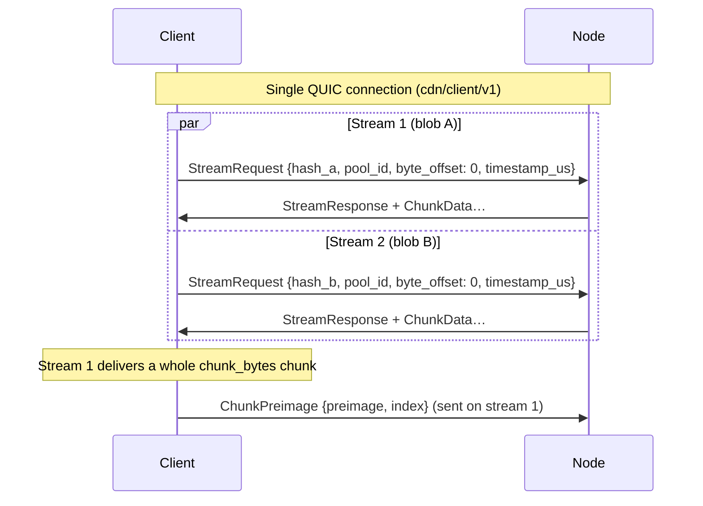

# ADR 005: Wire Protocol

**Date:** 2026-03-28
**Status:** Accepted

## Context

Nodes and clients communicate over QUIC connections established via iroh. This ADR defines what protocols run over those connections: how a client or node requests a blob and pays for it, and how a node discovers content across the network.

The protocol layer is distinct from the transport layer (iroh/QUIC) and the payment layer (vouchers, pools) so each can evolve independently.

## Decision

Two core protocols negotiated via ALPN:

| Protocol | Participants | Purpose |
| --- | --- | --- |
| `cdn/client/v1` | requester ↔ node | Holder discovery and paid blob delivery (client→node, node→node on cache miss). A discovery open is a stream that carries no voucher yet |
| `cdn/dht/v1` | any node ↔ any node | Kademlia content discovery (FIND_VALUE / STORE / FIND_NODE) — see [ADR 022](022-content-discovery.md#adr-022--content-discovery-at-scale) |

There is no protocol-level role for settlement monitoring — settlement events are public on the payment chain and vote-weight sweeps are public on the governance chain, so anyone may analyze them off-chain.

Discovery and delivery use one protocol. A requester learns the quote, the proven size and the coverage of a node from the answer to a stream. The requester then pays on that stream, or cancels it ([§ Discovery opens](#discovery-opens)).

### `cdn/client/v1` — paid delivery protocol

Used for all delivery and all discovery: client→node and node→node (cache miss pull from an origin-backed or cached node). A delivering node MAY satisfy a request for a blob it does not hold by pulling through from the network — not only from its own configured origin — and serving the result, paced by the requesting stream's credit as [ADR 037](037-regional-proxy-warming.md#adr-037-latency-driven-proxy-warming-for-regional-locality) describes; this is the mechanism that warms a regional copy. The node runs this miss path only for a request that sets `pull_through` ([§ Pull-through](#pull-through)). A discovery open does not set it, so a warming proxy that lacks the blob refuses a discovery open and never advertises a blob it lacks. A node that neither holds the blob nor can reach a provider for it answers `NotFound` ([Open-time refusal classes](#open-time-refusal-classes)).

```mermaid
sequenceDiagram
    participant P as Payer
    participant D as Delivering Node

    P->>D: StreamRequest {hash, namespace_id, payment_pool, pool_id, byte_offset, byte_len, timestamp_us} ++ Ext {binding?, capability?, pull_through}
    D->>P: StreamResponse {hash, ok, rate_per_mb, timestamp_us, slash_sig} ++ Ext {outcome: Served(size_proof) | Refused(error), origin_attestation?, coverage, payment_pools?}

    alt ok = true and the payer picks this node
        P->>D: Voucher {sig, amt, chain_root, chunk_price, stream_bytes: 0} (opens the chain; the node runs funding admission on the first voucher)
        loop Every chunk_bytes (1 MiB)
            P->>D: ChunkPreimage {preimage, index} (ahead of the chunk, within the payer's credit window)
            D->>P: ChunkData {bytes} (sender-sized frames, sent against the stream's credit)
        end
        P->>D: Voucher {sig, amt, chain_root', chunk_price, stream_bytes} (closing amount-voucher: folds the chain, rolls to a fresh root, states the residual it pays)
        P->>D: StreamEnd
    else the payer picks another node
        P->>D: stream reset (cancel)
    end
```

#### Discovery opens

A requester finds the holders of a blob with the stream that it pays on. A discovery open is a `StreamRequest` that the requester sends before it picks a node. The requester sends no voucher on it until it picks that node.

The requester opens one stream on each candidate at the same time. Each request names the pool and the span that the requester plans to fetch first. It does not set `pull_through`. It carries the client binding, as on any stream ([§ Client identity binding](#client-identity-binding)). There is no unauthenticated open. The node gives a discovery open the same `StreamResponse` that it gives a paid request:

- `ok: true` with the size proof in `StreamResponseExt.outcome` (`Served(size_proof)`). The node holds the span, or it serves the span from its own origin with a proven size ([§ Bounded byte ranges](#bounded-byte-ranges)).
- `ok: false` with a refusal class ([Open-time refusal classes](#open-time-refusal-classes)). On a miss, the node refuses at once and does no upstream work ([§ Pull-through](#pull-through)).
- `rate_per_mb`, the quote of the node, on every answer.
- `coverage`, the unsigned hint of the 64 MiB discovery blocks that the node holds or can serve, on every answer ([§ Coverage consistency](#coverage-consistency)).
- `payment_pools`, the unsigned hint of the `PaymentPool` contracts that the node accepts, on every answer ([§ Payment pool routing](#payment-pool-routing)).

The requester verifies each answer before it uses the answer ([§ Signer binding](#signer-binding)). A client ranks the nodes that served by path RTT, then by quote, then by coverage ([ADR 039 § Source set and selection](039-multi-source-parallel-fetch.md#source-set-and-selection)). A node ranks them by the unified selection score ([ADR 001 § Node Selection Algorithm](001-network.md#node-selection-algorithm)). The requester pays on the stream of the node that it picks: the discovery stream becomes the first paid leg, narrowed to the leg when the leg is shorter, so the requester opens no second stream to that node. The requester cancels every other stream with a stream reset. A cancel costs the node no more than the answer, because the node did no fill work and ran no funding admission ([§ Deferred admission](#deferred-admission)).

A refusal with a non-empty coverage names a partial holder. The node holds those blocks, but not all of the span. The requester can open ranges inside those blocks with `pull_through` set.

The answer states only "I serve these bytes at this rate". It does not tell origin from cache. Origin status is a publisher-level commitment that `OriginAssignment` records ([ADR 011 § Origin Assignment Authority](011-content-takedown.md#origin-assignment-authority)), and anyone can read it with `OriginAssignment.getOrigins(namespaceId)`. Cache-only serving is permissionless and looks the same as origin serving on the wire. This is correct, because clients verify the bytes via BLAKE3 whoever serves them.

A client whose persisted peer store holds enough fresh peers does not send discovery opens. It ranks those peers by their stored RTT, and each lane opens its own stream with `pull_through` set ([ADR 037 § Client selection policy](037-regional-proxy-warming.md#client-selection-policy-latency-driven-proxy-preference)).

**Path RTT.** The RTT that ranks a node is the QUIC path RTT of its connection. It is never the time from the request to the answer. A node can do work before it answers, for example an origin read, and that work says nothing about the distance to the node. A first exchange on a new connection uses the relay until hole punching selects a direct path. So the requester waits up to 500 ms after the answer for a direct path. When no direct path comes, the requester takes the RTT of the selected path and marks it not direct.

**Bounds.** A client bounds each discovery open at 5 s. It holds at most 8 discovery opens on one node at a time. A node bounds each discovery open of its miss path at 2.5 s (`OPEN_CEILING`): 1 s for the dial, 1 s for the exchange, and the 500 ms path grace.

**A discovery open is public information.** The answer shows content availability, the quote and the node identity. None of this is confidential. Node identities are in a public on-chain registry. An open needs a pool and a verified client binding, but a client can make a binding for a new key at no cost. So any party can map availability and quotes by bulk opens. This is inherent to a system where nodes must be discoverable to serve content. The request rate limit ([§ Request rate limiting](#request-rate-limiting)) and the unadmitted-stream cap ([§ Open-stream pin](#open-stream-pin)) bound the cost of bulk opens to the node. The signature on an answer exists for accountability, not for confidentiality.

#### Coverage consistency

No signature covers `coverage`. It is a hint. It decides no payment and no slash. The requester checks it against the signed body and the requested span (`StreamResponseExt::consistent_with`). It drops an answer where they disagree, as it drops an answer with a bad signature:

- An `ok: true` answer covers every block that the span touches below the proven size.
- An `ok: false` answer has an empty coverage, or a coverage that does not cover the span.
- The answer for the empty blob (`EMPTY_ROOT`) has an empty coverage.

The coverage bitmap holds at most `MAX_COVERAGE_BLOCKS` blocks (1,600 blocks, 100 GiB at 64 MiB). A block at or past that bound is unknown, not absent, and the check ignores it.

#### Pull-through

`StreamRequestExt.pull_through` tells a node whether it may run its miss path before it answers. The flag is unsigned. Its default is `false`.

- **`false`.** A node that does not hold the span answers at once with a signed `ok: false` (`NotFound`). It does no DHT lookup, no upstream open and no origin fill for the request. A node that serves the span from its own origin with a proven size answers `ok: true`, whatever the flag.
- **`true`.** On a miss, the node runs funding admission first. Then it runs its miss path: DHT discovery, an upstream open and an origin fill ([ADR 037 § Node serving](037-regional-proxy-warming.md#node-serving-window-paced-pull-through)). It answers when it can serve, or when the miss path fails.

A discovery open does not set the flag. A paid leg sets it. Before admission, an open without the flag reads only this:

- one store lookup;
- for a blob that the node serves from its own origin, three origin reads that the node memoises per hash: a `HEAD` of the data object, the `{H}.sizeproof` object, and a `HEAD` of the `{H}.obao4` outboard;
- one signature.

So repeats of a hash reach the origin at most once per memo TTL, and an unpaid open never costs origin egress in proportion to the blob. The node reads the outboard and the first range window only after admission at the first voucher. If the origin cannot serve the range, the node refuses the stream with a `StreamError` before any `ChunkData`. It then memoises the hash as having no outboard, and the next open of the hash degrades: `NotFound` without the flag, or the buffered origin fill with it. An origin without an outboard answers `NotFound` with an empty coverage.

#### Deferred admission

A node runs funding admission before it sends a byte. Admission checks the pool status, the signer authorization, the capability, the lane and the deposit gate. When the node runs admission depends on the work that the answer needs:

- **No fill work.** A hit, a partial hit that covers the span, or a span from the node's own origin with a proven size. The node answers before admission. It runs admission when the first voucher arrives. A failure is a `StreamError` with the refusal class before any `ChunkData` ([Error Handling](#error-handling-and-retry-semantics)). The payer treats it as the same refusal that a signed `ok: false` states.
- **Fill work.** A miss with `pull_through` set. The node runs admission before the miss path. A failure is a signed `ok: false`.

So a discovery open costs the node no chain read, and an unpaid stream cannot spend the RPC quota of the node. Load shedding also waits for the first voucher on a deferred open, so an unpaid open takes no shed slot.

#### Open-stream pin

A node pins the blob of an open stream against capacity eviction ([ADR 040](040-cache-policy.md#pinning-durable-operator-evict-and-the-open-stream-pin-stay-engine-enforced)). The node takes the pin before it checks its store for the blob. It drops the pin on a miss, and takes it again when a fill lands. Otherwise the pin ends when the stream ends: on payment to the end, a cancel, a reset or a timeout. So capacity eviction does not remove the blob between the answer and the first voucher. A takedown or an operator evict still removes a pinned blob.

Without a bound, one peer could pin many blobs with unpaid opens and block capacity eviction for paid fills. Three bounds apply:

- **Per connection.** A node caps the streams on one connection that have not passed funding admission at `MAX_UNADMITTED_STREAMS_PER_CONNECTION` (10). The node reserves a slot when it accepts a stream, before it reads the request. A stream past the cap is reset with `RATE_LIMITED`, and the node signs no response for it. The slot is free when the stream is admitted or ends. A miss with `pull_through` set is admitted at its funding gates. Any other stream is admitted at its first voucher.
- **Per node.** Binding keys cost nothing, so one peer can open many connections. A node holds at most `MAX_UNADMITTED_PINS` (256) pins for streams that have not passed admission, over all its connections. This is one pin for each connection handler at the default `max_concurrent_handlers` (256). An open past this budget still answers, but it takes no pin, so its blob stays evictable. Admission pins the blob of every admitted stream for the rest of the stream.
- **In time.** A node waits for the first voucher of a stream that has not passed admission for a fixed `VOUCHER_READ_TIMEOUT` (10 s) from the answer. Traffic on other streams of the connection does not extend this wait. Then the stream ends and its pin ends.

A client keeps its own streams inside the per-connection cap. It holds at most `MAX_UNADMITTED_STREAMS_PER_CONNECTION` opens on one node's connection, from the open until the first voucher of the stream, or until the stream is cancelled or fails. This includes discovery opens, lane opens, gap fills and retries, and the upstream opens of a node. Discovery opens use at most 8 of these places, so lane opens always have room. An open past the client's bound waits for a free place. It is never reset.

#### Rate bounds

A node advertises its configured `rate_per_mb` verbatim in every `StreamResponse`. The node never rewrites its own quote to a floor: the delivery floor is not a quote gate. A rate below the floor still sells and settles; `PaymentPool.redeem` clamps only the vote-weight byte credit for sub-floor bytes (see [ADR 003 § Rate-floor enforcement](003-payments.md#rate-floor-enforcement)). The floor is redemption-time contract state, so a node reads it for no wire decision. `MAX_RATE_PER_MB` = 1000 base units per MB (~$1/GB, ~100× the expected market rate) bounds `rate_per_mb` from above at the wire layer — the largest `rate_per_mb` the wire decodes — and the contract caps `deliveryFloor` at the same constant, so the floor can never exceed the wire price. The cap sits near real prices on purpose: a floor set close to a far-above-market ceiling would clamp credited bytes toward zero and suppress ADR-036 vote-weight accrual, so a realistic ceiling bounds that suppression while still catching below-market bytes.

#### Rate self-enforcement

The requester protects itself against the price. It needs no slash for this:

- The quote is in the signed answer, so the requester sees the price before it pays anything.
- A requester refuses a quote above its own ceiling (`max_rate_per_mb`). A client drops such a node from discovery, and a lane refuses such a stream. This is local policy. No governance ceiling is necessary.
- Each lane has a rate ceiling for the fetch. The ceiling is the first verified quote of the lane's node in the fetch. This is the node's discovery answer. If no discovery answer quoted the node, it is the first stream that a lane opens on the node. When `max_rate_per_mb` is set, the ceiling is the lower of the two. A later stream on the lane (a stripe leg, a gap fill, a retry or a resume) that quotes above the ceiling is refused unpaid. The node then leaves the fetch, and the other sources take its ranges. So a node cannot win ranking at one quote and then charge a higher rate for the rest of the fetch.
- The requester signs the price into each voucher as `chunk_price`. The node refuses a voucher whose `chunk_price` is not its quote (`ChunkPriceMismatch`), and a voucher that pays below its quote for the span that the voucher adds (`Underpaid`). See [`VoucherRejected` semantics](#voucherrejected-semantics).
- A rebase never moves a lane below the price of the bytes that it verified. Each verified byte has the price of the stream that verified it. A later rate never prices an earlier byte.

So a requester pays only a rate that it saw in a signed answer and accepted. There is no rate slash: the client protects itself by its lane ceiling and by signing the price into each voucher.

#### Client identity binding

For clients using ephemeral (off-chain) NodeId-to-Ethereum-address bindings (see [ADR 003 — Off-Chain Ephemeral Binding](003-payments.md#off-chain-ephemeral-binding-for-clients)), the binding is conveyed via optional fields in `StreamRequest`:

```rust
struct StreamRequest {
    hash: Hash,
    namespace_id: U256,  // 0 = namespace not named (DHT and attesting origins only); non-zero also routes to that namespace's authorized origins
    payment_pool: PoolAccount,  // CAIP-10 id of the PaymentPool contract that holds `pool_id`, e.g. "eip155:42161:0xab…"
    pool_id: PoolId,
    byte_offset: u64,
    byte_len: u64,       // 0 = to end-of-blob; else bound the range to [byte_offset, byte_offset + byte_len)
    timestamp_us: u64,
    // Ephemeral client binding (optional; required on first request per connection)
    ethereum_address: Option<Address>,
    binding_signature: Option<Bytes>,  // EIP-712 BindNodeId signature
}
```

The client includes `ethereum_address` and `binding_signature` in the first `StreamRequest` on a connection. The node verifies the EIP-712 signature via `ecrecover` and caches the verified binding for the connection's lifetime. Voucher attribution does not come from the binding: the address a voucher must recover to is the capability-authorized `signer` for the pool ([ADR 003 § PaymentPool](003-payments.md#paymentpool)). The binding is a gate against it — a request whose voucher `signer` is not the bound address is refused before any bytes are delivered, since its vouchers would fail verification anyway. Subsequent requests on the same connection may omit these fields. These are `Option` fields in the `StreamRequestExt` extensions struct, defaulting to `None` when absent via the two-phase deserialization pattern defined in [ADR 013](013-schema-evolution.md#tier-1--minor-no-coordination). Peers that do not send them (e.g., nodes in node-to-node pulls where both sides have on-chain bindings) produce frames without extension bytes, and the receiver fills `StreamRequestExt::default()` — no ALPN version bump is needed since this is defined before the first implementation.

**Voucher wire format:** `Voucher {sig, amt, chain_root, chunk_price, stream_bytes}` above is shorthand. The EIP-712 signed data covers the full structure from [ADR 003](003-payments.md#adr-003-payment-model): `{poolId, signer, provider, amount, bytesDelivered, chainRoot, chunkPrice}`. The fields `signature`, `amount`, `chain_root`, and `chunk_price` are transmitted on the wire. The voucher also carries one unsigned field, `stream_bytes` (`u64`, a postcard varint, the last field). It states the bytes of the lane's payment that the voucher pays to the stream that carries it: the residual on a closing voucher, and `0` on a voucher that pays no new bytes ([ADR 003 § Credit Window](003-payments.md#credit-window)). No signature covers it, because the node credits a stream at most the lane payment that no stream has claimed. The rest are derived from stream context — `pool_id` is in `StreamRequest`, `signer` is the requester's verified Ethereum address (from the ephemeral `StreamRequestExt` binding when present, otherwise from the requester's on-chain registration, as in node-to-node pulls), `provider` is the delivering node, and `bytesDelivered` is the node's per-lane cumulative byte counter. Vouchers carry no nonce — ordering and replay are handled by the monotone cumulative `amount` alone, and preimages by their chain index (see [ADR 003 § Voucher ordering](003-payments.md#voucher-ordering)). The receiver reconstructs the full typed data to verify the signature.

#### Signer binding

The delivering node advertises its `rate_per_mb` in `StreamResponse`. The payer accepts by sending the first voucher, or it cancels the stream and tries another node. There is no surprise pricing. `timestamp_us` in `StreamResponse` is the requester-generated microsecond timestamp from `StreamRequest`, echoed back unchanged. `slash_sig` is an EIP-712 secp256k1 signature over `{hash, ok, rate_per_mb, timestamp_us}`, signed with the operator's Ethereum key registered in `CapacityBond` ([ADR 003 § NodeId-to-Ethereum Binding](003-payments.md#nodeid-to-ethereum-binding)) and verifiable via `ecrecover` — see [ADR 014](014-on-chain-verification.md#adr-014-on-chain-verification-for-slashing-evidence). It is mandatory and non-empty on every `StreamResponse`. The signed-field set is the v1 baseline; per [ADR 013 § Signed Field Freezing](013-schema-evolution.md#signed-field-freezing), any change to this set is a Tier 3 ALPN bump. Signing the full response prevents a malicious party from altering unsigned fields while reusing a valid signature — `ok` is a message-integrity field that ensures a node cannot silently alter delivery status without accountability. A signed `ok: true` for a blacklisted hash is the evidence of the one slashable offense, a blacklist violation ([ADR 014 § Blacklist violation](014-on-chain-verification.md#blacklist-violation)). The existing `Max evidence age` parameter ([ADR 009](009-governance.md#adr-009-governance-model)) bounds the age of evidence, so honest operators are never exposed to indefinite slash risk from old responses. **Submitting slash evidence requires a 100 TOKEN challenge bond** — see [ADR 026 § Slashing and burn](026-tokenomics.md#slashing-and-burn) — returned if the challenge succeeds, forfeited if it fails, preventing zero-cost griefing via fabricated slash claims. A requester MUST stamp `timestamp_us` from its current wall clock. The node refuses a `StreamRequest` whose `timestamp_us` differs from its own clock by more than 30 seconds. The refusal is a stream reset with the `TIMESTAMP_SKEW` error code ([ADR 013 § Application Error Codes](013-schema-evolution.md#application-error-codes)) and no signed response. So every timestamp the node signs lies within 30 seconds of its clock at admission. The node checks the timestamp once, at admission. Later responses on the stream sign the same timestamp as it ages, so a transfer can run longer than 30 seconds.

Connection-level peer identity is authenticated by the iroh QUIC handshake against the registered NodeId (Ed25519). Message-body attribution and on-chain slash evidence both rely on `slash_sig`: verifiers recover the Ethereum address via `ecrecover` (3,000 gas on-chain) and confirm it maps to the expected NodeId via `CapacityBond.nodeIdOf` ([ADR 003 § NodeId-to-Ethereum Binding](003-payments.md#nodeid-to-ethereum-binding)). There is no opt-out. Requesters MUST reject responses with missing or zero-length `slash_sig`, and MUST recover the signature to the peer's registered operator address before acting on the response. A length check alone leaves the quote unattributed: selection reads `ok` and `rate_per_mb` off the response, and neither binds the peer to anything until the signature recovers. A response that fails to verify is dropped as requester-local policy — it MUST NOT be scored against the peer, because a signature that does not recover attributes nothing to anyone. See [ADR 014](014-on-chain-verification.md#adr-014-on-chain-verification-for-slashing-evidence) for the EIP-712 type definition and the `SlashJudge` contract interface.

**Origin attestation.** A `StreamResponse` with `ok: true` carries the origin attestation that the delivering node holds for the hash, in the unsigned extension field `origin_attestation`. The field has the `OriginAttestation` shape of [ADR 022 § Origin Attestation](022-content-discovery.md#origin-attestation): the signed fields and signature of a seated origin's own `StreamResponse` for the hash. A seated origin that serves from its backend leaves the field empty, because its own `StreamResponse` is the attestation. A relay stores the attestation from its pull leg and publishes its DHT records with it. A client ignores the field.

#### Namespace routing

`StreamRequest` carries `namespace_id`, the namespace the content is published under (see [ADR 002 § Retrieval by namespace](002-content-addressing.md#retrieval-by-namespace)). The delivering node routes on it:

- **`namespace_id != 0`** — the node resolves the namespace's authorized origins via `OriginAssignment.getOrigins(namespace_id)` ([ADR 011 § Origin Assignment Authority](011-content-takedown.md#origin-assignment-authority)) and, on a cache miss, pulls from one of them. If none hold the bytes, the fetch fails.
- **`namespace_id == 0`** — the request does not name the namespace. A discoverable hash needs none: its DHT records carry the attestation of a seated origin. The node serves from its local cache, from DHT-discovered holders, or from the origins that those holders' attestations name ([ADR 022 § Origin Attestation](022-content-discovery.md#origin-attestation)). A cache miss with no valid DHT record fails with `NotFound`.

`namespace_id` is a **routing hint, not a trust anchor**: the returned bytes are verified against the BLAKE3 `hash` independently ([ADR 002](002-content-addressing.md#adr-002-content-addressing)), so a wrong or hostile `namespace_id` can only cause a failed fetch, never corrupt or mis-attributed delivery. The requester supplies the `(namespace_id, hash)` association, which the application already knows.

Like `byte_len`, `namespace_id` is part of the base `StreamRequest` (every node routes on it), and because `cdn/client/v1` is pre-finalisation it is a straight in-place addition with no version bump or compatibility shim.

#### Payment pool routing

A pool id is unique only inside one `PaymentPool` contract. Many payment chains run at once, and one chain can run many `PaymentPool` contracts: a publisher or an operator can deploy its own. `StreamRequest` therefore carries `payment_pool`, the CAIP-10 account id of the contract that holds `pool_id`. Each node accepts a configured list of contracts on each of its payment chains. The node routes on `payment_pool`:

- **A contract the node accepts.** The node reads the pool, checks the voucher domain and redeems against that contract. The voucher domain binds the chain id and the contract address of `payment_pool` ([ADR 003 § PaymentPool](003-payments.md#paymentpool)).
- **A contract the node does not accept.** The node answers `Declined` before it reads any pool state. The refusal carries the node's accepted contracts in `payment_pools`, as every answer does. The list does not name the requested contract, so the requester can tell this refusal from a `Declined` of the blob. A requester that can pay through a listed contract retries this node once on that contract: it holds a pool in that contract, or it can open one. Otherwise it removes the node as for any `Declined`. A requester retries a node at most once in a fetch, so a node that refuses every contract cannot keep a fetch running.

**Accepted payment pools.** The unsigned extension field `payment_pools` of every `StreamResponse` lists the CAIP-10 account ids of the `PaymentPool` contracts against which the node redeems vouchers ([ADR 016 § Deployment Tiers](016-contract-interactions.md#deployment-tiers)). The node sets it on a served answer and on every refusal, so a discovery open tells the requester where the node is paid. A payment chain can run many `PaymentPool` contracts, and the node accepts a configured list of them on each chain. The list holds at most 8 entries, and a receiver ignores any entry past the eighth. The field is a hint, and `slash_sig` does not cover it. A wrong hint costs the requester one refusal, because the node checks `payment_pool` on every `StreamRequest`. A requester picks a contract that is in both this list and its own configured contracts. It prefers a contract where it already holds a pool over one where it must open a pool. A node that omits the field accepts only the contract that the requester already knows from its pinned configuration: the first contract in the requester's configuration.

**Discovery on several contracts.** A discovery open names a pool on the requester's most preferred contract: a contract where it holds a pool, else its first configured contract. A node that does not accept that contract refuses it, names the contracts it accepts, and says nothing about the blob. The requester keeps such a node as a serve target, routed by its list. The first pass runs on the first contract of the requester's order that a holder is routed to. A stream that a discovery open left on another contract is not adopted, and the lane opens its own.

A requester pays through one contract at a time, because its deposit gate covers one pool. A fetch therefore runs one pass for each contract that at least one node is routed to, in the requester's order of preference. Each pass fetches only from the nodes routed to its contract. A file download resumes its partial file in the next pass. A bundle pull runs the same passes over its files. A pass skips each file that an earlier pass completed, and resumes each partial file. A stream that wrote bytes does not run another pass, because the bytes it wrote cannot be taken back.

A node that pulls a cache miss from an upstream node is a requester too. It pays through one of its own accepted contracts: the first one by the same order of preference. Its discovery opens name a pool on that contract. It pulls only from an upstream whose `payment_pools` hint routes it to that contract.

**Pool identifier.** `PoolAccount` is a CAIP-10 account id: a CAIP-2 chain id, a colon and an account address, such as `eip155:42161:0xab16a96d359ec26a11e2c2b3d8f8b8942d5bfcdb`. The chain id is a namespace, a colon and a reference. It holds at most 41 bytes, and the namespace and the reference use the CAIP-2 character sets. The address holds 1 to 128 characters of the CAIP-10 character set. So a `PoolAccount` holds at most 170 bytes. A receiver rejects an identifier that breaks these rules. An EVM chain uses the `eip155` namespace and its EIP-155 chain id. An EVM contract address is `0x` and 40 hex digits. The receiver compares it without regard to case. Any other kind of chain uses its own namespace, so a non-EVM payment chain needs no change to this message.

`payment_pool` is part of the base `StreamRequest`. Every node routes on it, and the voucher it selects has no meaning without it. Because `cdn/client/v1` is pre-finalisation, it is a straight in-place addition with no version bump and no compatibility shim. A request is not signed, so `payment_pool` adds no signed field. The signed `StreamResponse` fields do not change.

#### Seek and resume

`byte_offset` supports seek and resume: on failover, the requester reconnects to a different node and resumes from the last BLAKE3-verified byte.

#### Bounded byte ranges

`byte_offset` is the start of a request; `byte_len` bounds its **end**. A request expresses the half-open range `[byte_offset, byte_offset + byte_len)`, with `byte_len == 0` meaning "to end-of-blob" (whole-tail behavior, so an absent or zero value is the default). A bounded range lets a node scope a cache-miss **origin** fetch to exactly the requested bytes rather than pulling the whole blob to serve a fraction of it — see [ADR 037 § Origin-tier pull-through](037-regional-proxy-warming.md#origin-tier-pull-through-ranged-fetch--external-outboard). It also scopes payment: `total_bytes`, the size the served response's size proof states, stays the **full blob size** — the buyer derives remaining bytes as `total_bytes - byte_offset`, and the serving node needs the blob size to frame bao verification of the range — while the **delivered, metered** byte count for a bounded request is `min(byte_len, total_bytes - byte_offset)`, or the whole tail (`total_bytes - byte_offset`) when `byte_len == 0`.

`byte_len` is part of the base `StreamRequest` (not an optional extension): it is billing-relevant. A node that ignored it would over-deliver and over-bill with no slash evidence. Every node must understand it. Because `cdn/client/v1` is pre-finalisation (no testnet deployment), this is a **straight in-place addition** to the message, not a Tier-3 evolution: there is no version bump and no compatibility shim ([ADR 013 § Schema evolution](013-schema-evolution.md#adr-013-schema-evolution)). The node MUST reject a `byte_offset` at or past the blob end with a `StreamError`. When a range's end overflows or runs past the blob end, the node serves the range up to the blob end.

**A node proves the blob size.** A **size proof** is the only way a message states a blob size. It holds the size and the bao encoding of the final BLAKE3 chunk of a blob of that size at chunk granularity ([ADR 038](038-bao-verified-range-streaming.md#adr-038-bao-verified-range-streaming-on-cdnclientv1)): the chunk (at most 1 KiB) and one pair of parent hashes (64 bytes) for each level on the path from that chunk to the root. A proof for a blob of 100 GiB is under 3 KiB. BLAKE3 binds the length of the input into the tree, so only the true size verifies a final chunk under the root. A `StreamResponse` with `ok = true` has a served outcome, and that outcome is its size proof: the response has no other size field, so a served response without a proof cannot exist. The receiver MUST verify the proof against the content hash before it uses the size: before it plans or splits ranges, allocates, compares the size with a cap, or pays against it. A receiver that gets a proof that does not verify treats the response as a fault of that node.

A size proof depends on the hash alone. It names no node and carries no signature, so any party that holds one can pass it on. No signed field of a response holds the size, and no DHT record holds it. An origin makes the proof when it imports the blob and stores it beside the outboard, as the object `{H}.sizeproof`: the size as 8 little-endian bytes, then the proof. This object is the origin's statement of the size. A node reads no other origin source for a proof, and it serves no origin object without one: an object with no size, or with no `{H}.sizeproof`, is not served from the origin and is not advertised. A node that pulls a blob keeps the proof that it verified from its upstream, and it serves that proof before it holds the tail of the blob. A node states no size that it cannot prove:

- A node builds a proof from the last chunk group when it holds that group. It reads the proof of an origin object from `{H}.sizeproof`. It keeps the proof with the blob. When the node evicts the blob, it drops the proof.
- A node that cannot prove the size does not answer `ok: true`. Its refusal names no block.
- A partial holder that has no proof and does not hold the last chunk group serves the request as a cache miss. Its upstream pull brings the proof.
- A node keeps the proof of each blob that its store holds as a named tag, so the proof survives a restart. The tag points at the empty blob, so it keeps no content alive. A proof for a blob that the store does not hold stays in memory. The node deletes each tag whose blob its store no longer holds, at startup and on each origin rescan.
- A node remembers an origin lookup that found no `{H}.sizeproof` for a few seconds. For each hash, it runs one origin read of `{H}.sizeproof` at a time.

The proof carries the last bytes of the blob, unpaid: at most 1 KiB, and the whole blob when the blob is no longer than one BLAKE3 chunk.

#### Payment quantum and credit window

The `cdn/client/v1` byte-accounting granularity is fixed at 1 MiB (`CHUNK_BYTES`). Both the payer and the delivering node derive chunk boundaries from this constant, so it carries no wire field and there is nothing to negotiate ([ADR 003 § Chunk Cadence](003-payments.md#chunk-cadence)).

The protocol is self-enforcing: payer stops sending proofs → delivering node stops sending chunks; delivering node stops sending chunks → payer stops sending proofs.

A proof is one of two messages. A `Voucher` is signed and carries the lane's cumulative `amount` plus the `chain_root` that heads the current hash chain. A `ChunkPreimage` is unsigned and advances that anchor by one chunk without a signature ([ADR 003 § Hash-chain metering (PayWord)](003-payments.md#hash-chain-metering-payword)):

```rust
/// Released by the payer to pay for one chunk, ahead of that chunk.
///
/// Wire encoding: `preimage ‖ index`, 33 bytes flat — no length prefix, no
/// varint. The byte IS the index: releasable indices are `1..=MAX_CHAIN_LENGTH`
/// and encode directly, with no offset. `index == 0` is a protocol error —
/// index 0 is the settlement case at redemption and never travels the wire.
ChunkPreimage { preimage: [u8; 32], index: u8 }
```

```rust
/// The payment quantum. A protocol constant, never negotiated.
pub const CHUNK_BYTES: u64 = 1_048_576;
/// The highest chain index: the chain's incremental range over its anchor.
///
/// The index space is the `u8` domain `0..=255` — 256 slots, exactly one byte.
/// Index 0 names `chain_root` and resolves to the voucher's own `amount`, so
/// the base voucher is payable with no chain at all; it adds no increment,
/// which is why it never travels the wire. Indices `1..=255` each release one
/// preimage and add one `chunk_price` over that anchor, so a chain adds up to
/// 255 MiB at `CHUNK_BYTES`. 256 slots = one payable base + 255 increments.
pub const MAX_CHAIN_LENGTH: u8 = 255;
```

The decoded byte is the chain index as-is, with no widening and no conversion. The node verifies a preimage by hashing it forward to the deepest preimage it already holds on that lane, and advances the lane-wide chain index whichever stream carried the message. The preimage pays one chunk to the stream that carried it.

**The index is one byte end to end.** The same `u8` that names an index here is the low byte of the packed `chainMeter` word the node later submits on-chain ([ADR 003 § Voucher signatures are compact](003-payments.md#voucher-signatures-are-compact-and-their-signers-are-eoas)), so the wire and the calldata agree on the representation and neither side converts. That is also where the chain length comes from: it is a property of the index type, not a check either layer performs. The `u8` domain `0..=255` is the index space — 256 slots. Index 0 names the root and settles the voucher's own `amount`, adding no increment, so it never travels the wire. The releasable range is therefore `1..=255`: 255 incremental steps over an already-payable base, adding up to 255 MiB.

Delivery and payment are not lock-stepped at the chunk. A payer pays ahead within a **credit window** of several chunks ([ADR 003 — Credit Window](003-payments.md#credit-window)), and a node sends a frame only when the stream's confirmed payment covers it. There is no per-proof acknowledgement on the wire. The node's delivery is the implicit acknowledgement: a proof that the node does not accept stops delivery, and the payer sends it again. The window is payer policy and appears in no wire field. It bounds the payer's exposure to one window of payment ahead of delivery on each stream, and the node's exposure to unpaid delivery is zero. At a window of one chunk this is strict stop-and-wait, so the two ends interoperate at any window that the payer chooses.

> **Relationship to iroh-blobs:** The `cdn/client/v1` protocol wraps iroh-blobs' verified streaming within its own message framing. iroh-blobs provides BLAKE3 tree-hash verification at the chunk level; `ChunkData` payloads carry the bao interleaved verified-stream encoding (chunk-group data with the proof nodes that anchor it to the root), alongside the payment and delivery control messages (`Voucher`, `StreamEnd`, `StreamError`) that iroh-blobs' native transfer protocol does not support. The BLAKE3 content hash in `StreamRequest` is the iroh-blobs hash, and verification uses iroh-blobs' incremental tree-hash mechanism — receivers need not buffer the full blob before confirming integrity, and a range beginning at any `byte_offset` is verifiable against the root on its own. See [ADR 038](038-bao-verified-range-streaming.md#adr-038-bao-verified-range-streaming-on-cdnclientv1) for the verification model and wire encoding.

### Node metadata

Node-level metadata is a single field: the node's self-reported region. A node declares its region on-chain as `regionHint` at `CapacityBond.registerNode`. The `CapacityBond` registry refresh resolves the active set into a `NodeId → region` map. See [ADR 001 § Node Region Metadata](001-network.md#node-region-metadata) and [ADR 030](030-node-region-self-attestation.md#adr-030-node-region-self-attestation).

The region is an ISO 3166-1 alpha-2 country code. It is self-attested and accepted at face value. A client penalizes a node whose observed RTT contradicts the claimed region (e.g., RTT > 150 ms to a node in the same claimed region). See [ADR 001](001-network.md#adr-001-network-topology-and-peer-mesh) for the region-misreporting mitigation.

Content discovery uses `cdn/dht/v1` (O(log N) FIND_VALUE) with a discovery open on `cdn/client/v1` as live-availability confirmation. See [ADR 022](022-content-discovery.md#adr-022--content-discovery-at-scale). The discovery open determines which nodes hold specific content, along with their cost and latency.

### Connection Management

One QUIC connection per `(local_node, remote_node, ALPN)` tuple. Multiple requests to the same node on the same protocol reuse the existing connection via QUIC's native stream multiplexing — each `StreamRequest` opens a new bidirectional QUIC stream. A client fetching 100 blobs from one node opens 1 connection with 100 concurrent streams, not 100 connections.

Different ALPNs require separate connections (TLS ALPN is negotiated at connection establishment); a `cdn/dht/v1` connection and a `cdn/client/v1` connection to the same node are always distinct. Discovery opens and paid streams to one node share its `cdn/client/v1` connection.

Every deCDN implementation completes its full TLS 1.3 handshake before application bytes flow, on every ALPN: no request is ever sent as replayable early data. This binds implementations, not the wire — iroh accepts early data on any ALPN regardless of what the handler does, so the property is held on the emitter side (no code asks for early data) rather than enforced on receipt. TLS session resumption still applies — a client reconnecting to a node it has already spoken to skips certificate transmission and signature verification, though the ECDHE key exchange still runs — and steady-state cost is dominated by stream multiplexing on connections that stay open.

#### Concurrent stream limits

Maximum concurrent bidirectional streams per connection, set via QUIC transport parameter `initial_max_streams_bidi`:

| ALPN | Max streams | Rationale |
| --- | --- | --- |
| `cdn/client/v1` | 100 | Enough parallelism for bulk fetching (e.g., video manifest + segments) without exhausting server resources |
| `cdn/dht/v1` | 1 | Single request-response per Kademlia RPC (FIND_VALUE / STORE / FIND_NODE); the connection is reused for sequential queries to the same node ([ADR 022](022-content-discovery.md#adr-022--content-discovery-at-scale)) |

Stream concurrency is enforced via QUIC's `MAX_STREAMS` transport parameter: a peer MUST NOT open a new bidirectional stream beyond the advertised limit (doing so is a protocol violation resulting in `STREAM_LIMIT_ERROR` and connection close). The receiver grants additional credit by sending `MAX_STREAMS` updates as existing streams close.

On `cdn/client/v1` the node also holds a per-connection stream semaphore of 100 permits (`MAX_CLIENT_STREAMS`, the `cdn/client/v1` row above). A stream that finds no permit is reset with `RATE_LIMITED` before the node reads its request, and the node signs no response for it. Thus an over-cap stream does not buffer a request frame or cost a signature. Together with the frame ceilings and the connection receive window, this bounds the memory that stalled peers can hold ([ADR 013 § Wire Framing](013-schema-evolution.md#wire-framing)).

#### Request rate limiting

The node limits inbound `cdn/client/v1` requests with two layered token buckets. The node checks them once per stream, after the stream permit and **before** it reads the request. A stream that fails either layer is reset with `RATE_LIMITED` (`0x10`, [ADR 013 § Application Error Codes](013-schema-evolution.md#application-error-codes)), and the node signs no response for it. Checks fire narrowest-first (per-peer → global). The global layer charges its token only after the per-peer layer admits the request. A request that its own peer bucket refuses therefore spends no token of the global budget, so one `NodeId` that floods past its cap cannot starve the other requesters.

| Layer | Default refill | Default burst | Scope |
|---|---:|---:|---|
| Per-peer (NodeId) | 100 requests/sec | 400 | The source iroh `NodeId` on the QUIC connection. |
| Global node | 2000 requests/sec | 5000 | Single global bucket across all inbound `cdn/client/v1` requests to this node. |

Operators set the layers under `[serve.rate_limit]`. A rate of `0` turns a layer off.

**Why the node limits unpaid requests.** A request costs the node work before any payment binds it. Most refusals after the node reads the request carry a signed `StreamResponse`. An origin-only node sends its backend a `HEAD` for an unseen hash before it checks a lane or a payment. An unseen pool or signer costs a chain read. Without a limit, a peer can spend the node's signing capacity, origin requests and RPC quota on requests that never pay.

**Why these defaults.** One request is one stream, and an honest client opens one stream per pull leg, with up to 100 at once on one connection ([§ Concurrent stream limits](#concurrent-stream-limits)). A discovery open is one stream too, so a fetch spends one request on each candidate before it pays. A node pulling on a cache miss shares one `NodeId` across all its pulls. `decdn-client` reads a `RATE_LIMITED` reset as back-off, not as a fault.

**Why NodeId and global, not signer or IP.** The layers key on the connection, not on the voucher signer. A signer key is free to rotate, and a node keeps no per-signer rate memory ([ADR 003](003-payments.md#adr-003-payment-model)). The per-peer layer bounds a peer that keeps its `NodeId`. Clients are unstaked and can rotate `NodeId` for free ([ADR 003 § Discovery-open load](003-payments.md#discovery-open-load)), so a peer that rotates its `NodeId` meets only the global cap. The node keys no layer on the source IP. The relay does not show the client address to the node, so an attacker that dials through a relay skips such a layer at no cost. Honest peers behind one NAT share one address, so such a layer refuses them together ([#2505](https://github.com/decdn/decdn/issues/2505)).

**Metrics.** `decdn_serve_rate_limit_rejected_{per_peer,global}_total`, two sibling counters, unlabeled. Each refused stream counts on the counter of the layer that refused it first.

#### Payment lanes and concurrent streams

A single `pool_id` can be shared across concurrent streams on the same connection. Vouchers are cumulative across **all** streams on the lane (one `(signer, provider)` pair):



The payer maintains **one `chain_root` and one chain index per `(signer, provider)` lane** — the streams from one signer to one node. The payer releases one preimage on a stream for each whole chunk (1 MiB, `CHUNK_BYTES`) of that stream's range, ahead of delivery, up to its [credit window](003-payments.md#credit-window). Each preimage is the next index of the lane's one chain. A stream that joins a live lane continues the running chain and MUST NOT open a second root ([ADR 003 § One chain per lane](003-payments.md#one-chain-per-lane)). The delivering node pauses a stream when the stream's credit (`paid − sent` on that stream) cannot cover its next frame. Each stream holds its own credit. A preimage pays one chunk to the stream that carries it, and a voucher pays the stream its `stream_bytes`. The node credits a stream at most the lane payment that no stream has claimed, so the credit of all streams on a lane never exceeds what the lane paid. Credit does not carry from one stream to another.

**Routing differs by proof type.** A `Voucher` is self-describing: it carries a cumulative `amount`, so a higher one supersedes a lower one and arrival order across streams does not matter. That is what makes "sent on any active stream" safe for vouchers. A `ChunkPreimage` carries no amount — its worth is its depth in the chain — so it is placed by its `index`, not by when it arrives. Two rules make cross-stream interleaving safe, and [ADR 003 § Concurrent Streams](003-payments.md#concurrent-streams) states them in full:

1. **Each stream anchors itself.** A bare preimage does not name its chain, so each stream carries its own `(anchor voucher, chain_root, verified, tip)`, seeded from the `chain_root` voucher that anchors it (`verified = 0`, `tip = chain_root`). The epoch's root voucher MUST precede that stream's preimages for that epoch. The payer sends it immediately before the stream's first reveal, not at stream open. A stream that makes no reveal sends no anchor voucher: its closing voucher is its only voucher. After a rollover, the payer sends the new-root voucher on **each** stream immediately before that stream's next reveal. The payer does not send it on one stream and rely on the node to propagate it. QUIC orders messages within a stream. So each stream reads its old-chain preimages against its own old root before its own roll voucher arrives. A fast stream that has adopted `R₂` cannot strand a sibling still finishing `R₁`. A preimage on a stream with no anchor is rejected `UnanchoredPreimage`. Re-sending a voucher the node already holds is free — a metering voucher at or below the watermark is already-satisfied, and it pays no whole chunk ([ADR 003 § Concurrent Streams](003-payments.md#concurrent-streams)).
2. **The deepest preimage wins, per stream.** The node ignores `index ≤ verified` without hashing, and otherwise accepts when `keccak^(index − verified)(preimage)` reaches that stream's `tip`. There is no over-long-index check: `index` is a `u8` and `MAX_CHAIN_LENGTH` is 255, so a larger index cannot be encoded and the 255-hash bound holds by type. A fast stream may skip indexes a slower one has not reached.

The lane's claim is the **maximum** of the highest signed `amount` and each stream's `anchor amount + verified × chunk_price` — never a sum, because a rollover voucher already folds the retired chain into its own `amount`.

Implementation constraint: the payer must have a single voucher-signing and chain-advancing task per lane that all its streams share, not an independent chain per stream. It serializes the chain index and the rollover decision under a local lock while bytes stream concurrently. Per-stream anchoring places preimages; it does not shard the money.

#### Connection lifetime

- Connections remain open while any stream is active (on-chain pool closure does not affect connection lifetime).
- **Idle timeout:** 30 seconds after the last stream closes and no unacknowledged vouchers remain in flight. Endpoints SHOULD send periodic QUIC PING frames when otherwise idle, with a default interval of 10 seconds (below the idle timeout) to prevent NAT middleboxes from dropping the mapping.

### Error Handling and Retry Semantics

A node signals a stream failure by returning a `StreamError` code. The three open-time refusal classes ride in the initial response (`StreamResponse { ok: false, error: ... }`, transitioning `AwaitingResponse → Failed`). When the node defers funding admission to the first voucher ([§ Deferred admission](#deferred-admission)), an admission refusal rides in a `StreamError` message after `ok: true` and before any `ChunkData`, with the same class. The payment-side code (`VoucherRejected`) rides mid-stream in a `StreamError` message (transitioning `Streaming → Failed`). The lifecycle position is set by when the rejection becomes diagnosable — see [`VoucherRejected` semantics](#voucherrejected-semantics) below and the [Stream Lifecycle State Machine](#stream-lifecycle-state-machine):

```rust
enum StreamError {
    NotFound,  // "No": this node cannot serve the request now. Try other nodes; this node may answer differently later
    Declined,  // "No, and stop asking": this node will not serve this hash or request during this fetch
    Unfunded,  // "No at the current funding": this node will not serve this request at the requester's current pool deposit or signer capability
    VoucherRejected { reason: VoucherRejectReason, bundle: Option<WatermarkBundle> }, // Mid-stream payment-voucher rejection (carried in a StreamError message, not in the initial StreamResponse) — see VoucherRejected semantics below; `bundle` carries the node's true watermark on a watermark-gated reject
}

// Attached to a regression/exhaustion/Underpaid VoucherRejected so a delegated signer that
// cannot reconstruct its lane watermark from chain (a lane records nothing until
// its first redemption) can self-heal. Present only when the rejected voucher's
// signature recovered to the pool's authorized signer (below).
struct WatermarkBundle {
    amount: [u8; 32],          // node's cumulative accepted amount (lane watermark, NOT a blob byte position)
    bytes_delivered: [u8; 32], // node's cumulative accepted bytes_delivered
    chain_root: [u8; 32],      // root the lane is metering against (zero if none)
    verified_index: u8,        // deepest chain index the node has verified under that root
    tip: [u8; 32],             // preimage bytes at verified_index (zero if none)
    chunk_price: [u8; 32],     // price the accepted voucher was signed at
    last_signature: Vec<u8>,   // r‖s‖v (65 bytes) of the signer's own last-accepted voucher, echoed back for authentication
}

enum VoucherRejectReason {
    BadSignature,         // VoucherError::InvalidSignature — signature is malformed: corrupted bytes, non-canonical `s`, or invalid recovery id
    WrongSigner,          // VoucherError::WrongSigner — signature is well-formed but recovers to an address other than the voucher's authorized signer
    WrongPool,         // PoolError::WrongPool — voucher.pool_id mismatch
    WrongProvider,        // PoolError::WrongProvider — voucher.provider names another node; a node redeems only its own lane
    AmountRegression,     // handler-emitted on the serving path for a stale proof (a voucher at or below the signed anchor, or a reveal that folds nothing) whose chunk lane headroom cannot pay, and for a stream whose proof budget is spent while the stream's credit does not cover its next frame; a stale proof that headroom pays is ALREADY-SATISFIED. PoolError::AmountRegression maps here on the non-serving validation paths
    BytesRegression,      // PoolError::BytesRegression — cumulative bytes_delivered regressed on this lane, or the same amount carries different bytes
    SpendingCapExhausted, // PoolError::CapExceeded — voucher exceeds the signer's remaining spending cap
    CapabilityExpired,    // Signer's capability has passed its expiry — the node checks its LOCAL wall clock plus its expiry margin on every voucher and preimage, settlement gates on block.timestamp. Handler-emitted directly; no validation-enum counterpart
    PoolExhausted,        // Pool's remaining deposit, minus the refundable floor M, can no longer fund the next chunk; or the pool closed, or is Closing with its dispute deadline inside the node's redeem margin. Pool level only. Handler-emitted mid-stream after capability ownership is proven; no validation-enum counterpart
    SignerCapExhausted,   // Signer's shared on-chain cap − spent headroom, tracked across every provider, can no longer cover a serve floor. Signer level, distinct from PoolExhausted: the pool's remaining deposit can stay healthy while this signer's cap is spent. The admit-time equivalent is wire Unfunded, spoken only to a proven requester (ADR 003 § Pool solvency). Handler-emitted mid-stream after capability ownership is proven; no validation-enum counterpart
    BadPreimage,          // PoolError::BadPreimage — released value does not hash to the lane's deepest verified preimage in (index − verified) steps
    ChainIndexZero,       // index == 0 — index 0 is the redeem-time settlement case and never travels the wire. The u8 index cannot exceed MAX_CHAIN_LENGTH, so there is no over-large case to report. Handler-emitted; no validation-enum counterpart
    UnanchoredPreimage,   // Preimage arrived on a stream that holds no anchor, so the node cannot name the chain it belongs to. Per-stream and therefore decidable. Handler-emitted; no validation-enum counterpart
    ChunkPriceMismatch,   // Voucher's chunk_price is not the node's quoted rate_per_mb, or is non-zero on a sealed voucher (chain_root == 0). Handler-emitted; no validation-enum counterpart
    Underpaid,            // The span the voucher adds over the lane's accepted watermark pays below the quoted rate_per_mb. Carries the node's watermark. Handler-emitted; no validation-enum counterpart
    UnderFold,            // PoolError::UnderFold — at or above the signed anchor, the voucher names a chain_root other than the live one, but its amount or bytes_delivered does not fold the live chain's verified frontier. At exactly the anchor, only a voucher that opens a chain qualifies. Carries the node's watermark
}
```

#### Open-time refusal classes

A node has many reasons to refuse a stream. The wire carries only the three classes, because a requester acts on the class and never on the reason. The node keeps its finer reason in its own per-reason metrics ([Appendix: Observability](appendix-observability.md#appendix-observability-and-metrics)). No client reads them.

Every refusal scopes to the node that sent it, for the current fetch. A requester never ends a fetch on the word of one node. A requester classifies a refusal from the code alone, with no chain read. [ADR 039 § Failure handling](039-multi-source-parallel-fetch.md#failure-handling-reassign-only-tail) gives the outcome of a fetch whose every candidate refuses.

| Class | Meaning to the requester | Node reasons |
|---|---|---|
| `NotFound` | Try other nodes. Rediscovery can return this node, and it can serve later. | Cache miss. Load shed, on a hit or on a miss. Chain reads stale past the grace window ([ADR 011 § Serving while chain-stale](011-content-takedown.md#serving-while-chain-stale)). Pull-loop guard ([ADR 037 § Node serving](037-regional-proxy-warming.md#node-serving-window-paced-pull-through)). Unknown lane. A failed binding or lane-ownership proof. A pool or signer check that the node cannot complete because its RPC faults. No upstream route at or below the node's buy ceiling ([ADR 041](041-refuse-to-serve.md#no-route-is-a-valid-outcome)). The node's own upstream fill ends with "funding needed": the funding problem is the node's, not the requester's. A pool with no on-chain record, or a `Closed` pool: the node cannot tell either from an RPC fault or from a pool that its chain view has not caught up with ([ADR 003 § Funding recovery](003-payments.md#funding-recovery)). |
| `Declined` | Remove this node from the candidates for this hash for the rest of the fetch. | A foreign namespace that the node does not relay ([ADR 002 § Retrieval by namespace](002-content-addressing.md#retrieval-by-namespace)). A `payment_pool` that the node does not accept ([§ Payment pool routing](#payment-pool-routing)). A blob from this node's own origin that is larger than its `max_blob_size`, or a pull-through range that this node cannot land without holding more than `max_blob_size` of the blob (**`max_blob_size` enforcement** below). A hash on the governance blacklist or the local denylist. An origin on the on-chain origin blacklist or the local origin denylist ([ADR 011 § StreamRequest Response](011-content-takedown.md#streamrequest-response)). An internal error. A range that starts at or past the proven size of the blob. A blob that the node withdrew: an operator evict, or a quarantine of corrupt bytes ([ADR 040](040-cache-policy.md#pinning-durable-operator-evict-and-the-open-stream-pin-stay-engine-enforced)). |
| `Unfunded` | Park this node at the current funding for the rest of the fetch. It is asked again only after a funding recovery step ([ADR 003 § Funding recovery](003-payments.md#funding-recovery)). | The pool's remaining deposit minus the node's floor `M` cannot price one chunk. The signer's `cap − spent` is below the serve floor. The signer's capability has expired. The owner revoked the signer key ([ADR 003 § Revocation](003-payments.md#revocation)). The pool is `Closing` ([ADR 003 § Pool solvency](003-payments.md#pool-solvency-and-the-refundable-floor-m)). |

**`Unfunded` is gated on a proven requester.** The node speaks `Unfunded` only to a requester that passed the lane-ownership proof or holds a verified signer binding. Any other requester gets `NotFound` for the same state. So a requester cannot tell "no such content" from "this pool cannot pay", and pool and signer state stay unmappable off the wire ([ADR 003 § Pool solvency](003-payments.md#pool-solvency-and-the-refundable-floor-m)).

**A withdrawn blob is not slash evidence.** The only slashable offense is a blacklist violation ([ADR 014](014-on-chain-verification.md#adr-014-on-chain-verification-for-slashing-evidence)). No offense pairs an `ok: true` answer with a later refusal. A node withdraws a blob by an operator evict or by a quarantine of corrupt bytes, and a request for a withdrawn blob gets `Declined`. Capacity eviction does not withdraw a blob while a stream on it is open ([§ Open-stream pin](#open-stream-pin)). A high rate of these refusals means that the operator evicts often, or that the store finds corrupt bytes.

#### `VoucherRejected` semantics

`VoucherRejected` is delivered **mid-stream**, not as an initial response. By the time a node can reject a voucher, the stream has already transitioned `AwaitingResponse → Streaming` via `StreamResponse { ok: true }` and the client has sent at least one `Voucher` (the [Stream Lifecycle State Machine](#stream-lifecycle-state-machine) below). On rejection the node sends a `StreamError` message carrying `VoucherRejected { reason }`, transitioning the stream `Streaming → Failed`. The QUIC stream is then closed cleanly — **no QUIC stream reset and no application-error close code** — preserving the rejection reason for client diagnostics and letting the payer distinguish a payment rejection from a network failure (a bare stream reset with no application code collapses every rejection to "connection error").

The other `StreamError` variants (`NotFound`, `Declined`, `Unfunded`) are the open-time refusal classes. They ride in the initial `StreamResponse { ok: false, error: ... }` (transitioning `AwaitingResponse → Failed`), or in a `StreamError` message before any `ChunkData` when admission waits for the first voucher. `VoucherRejected` is the only variant scoped to the mid-stream `StreamError` message after admission; this asymmetry is intentional — each rejection's lifecycle position determines which carrier message is available.

**A mid-stream rejection also scopes to its node.** The funding reasons `PoolExhausted`, `SpendingCapExhausted`, `SignerCapExhausted`, and `CapabilityExpired` act as `Unfunded` from that node, once any watermark self-heal below fails. Every other reason that no bundle heals acts as `Declined` from that node. The requester reports the reason in the fetch result, and the final error of a fetch that every node declined names the reasons it collected ([ADR 039 § Failure handling](039-multi-source-parallel-fetch.md#failure-handling-reassign-only-tail)). A dishonest node can send any reason, so no reason ends the fetch on its own.

The first seven `VoucherRejectReason` variants, `BadPreimage`, and `UnderFold` mirror the off-chain validation enums `PoolError` / `VoucherError` (in `crates/incentive/`) one-to-one. The serving path also emits `AmountRegression` directly, for a stale proof that lane headroom cannot pay, and for a stream that spends its proof budget while the stream's credit does not cover its next frame; the bundle lets a trailing payer reseed. `BadPreimage` mirrors `PoolError::BadPreimage`, because the hash-chain walk is a lane-state check. The other three chain variants (`ChainIndexZero`, `UnanchoredPreimage`, `ChunkPriceMismatch`) are handler-emitted and have no validation-enum counterpart. `BadSignature`, `WrongSigner`, `WrongPool`, `WrongProvider`, `SpendingCapExhausted`, and `BadPreimage` avoid an on-chain `redeem` revert; the ordering and fold guards (`AmountRegression`, `BytesRegression`, `UnderFold`) have no on-chain counterpart — on-chain redemption is cumulative, so a stale voucher simply pays `0` — and exist to keep the node's own off-chain ledger consistent (see [ADR 003 § Redemption and Close](003-payments.md#redemption-and-close) and [ADR 003 § Off-chain Voucher Rejections](003-payments.md#off-chain-voucher-rejections-wire-encoding) for the per-reason mapping). The remaining variants have no validation-enum counterpart and are emitted by the `cdn/client/v1` handler directly: `CapabilityExpired` fires when the signer's capability has passed its expiry — the node holds the clock, so this is handler-direct rather than bridged through `PoolError`; `PoolExhausted` fires mid-stream when the pool's remaining deposit can no longer fund further credit, or when the pool closed or is `Closing` inside the node's redeem margin, after the client has already proved capability ownership; `SignerCapExhausted` fires mid-stream when the signer's shared cap headroom can no longer cover a serve floor, also after the client has proved capability ownership (see [ADR 003 § Pool solvency](003-payments.md#pool-solvency-and-the-refundable-floor-m)); and `Underpaid` fires when the span a voucher adds over the lane's accepted watermark pays below the quoted `rate_per_mb`. There is no floor-related reject reason: the pool settles a voucher priced below the delivery floor in full, and the floor prices only the vote-weight credit the governance chain's `FeeRouter` grants on a sweep, so the node keeps serving (see [ADR 003 § Rate-floor enforcement](003-payments.md#rate-floor-enforcement)). A transient node-side persist-write failure (`PoolError::Store`, surfaced internally as `RetrySignal`) carries no wire reject reason at all: the node aborts the stream cleanly instead, and the signer resends the same voucher on a fresh stream (see [ADR 003 § Off-chain voucher state persistence](003-payments.md#off-chain-voucher-state-persistence)).

**Watermark bundle (self-heal on regression, exhaustion, underpayment, and under-fold).** A delegated signer — one issued a capped capability by a pool owner — cannot reconstruct its off-chain lane watermark from the contract: a lane records nothing until its first redemption. An `AmountRegression`/`BytesRegression`/`SpendingCapExhausted`/`Underpaid`/`UnderFold` rejection would otherwise be a dead end. On exactly those five reasons, the node attaches a `WatermarkBundle` carrying its true cumulative `amount`/`bytes_delivered` plus `last_signature` — the `r‖s‖v` of the signer's own last-accepted voucher. Two signature gates keep the bundle from leaking a watermark or corrupting signer state:

- **Node attaches it only when the rejected voucher's signature recovers to the pool's authorized `signer`.** The node verifies the signature against the lane's pinned signer before any watermark check. A wrong-key voucher is rejected `WrongSigner` and never reaches the bundle, so a party who merely guessed the chain-derivable `poolId` gets no bundle. This keeps a lane's watermark private to the key that signs it. A `ChunkPreimage` carries no signature of its own. The node places a reveal only on a stream that a verified voucher anchored, so that voucher already proves the signer. A reveal gets the bundle on a self-heal reason: `AmountRegression` when it folds nothing and headroom cannot pay its chunk, and `SpendingCapExhausted` when it passes the cap. A spent proof budget attaches the bundle under the same gate: a proof-wait timeout ends the stream before the budget, so every proof the budget counted was a signer-verified voucher or a reveal placed against an anchor such a voucher set on that stream. `BadPreimage` is a hash-chain mismatch, which a payment watermark cannot repair, so it stays terminal. The bundle remains on exactly the five self-heal reasons.
- **Signer trusts it only when `last_signature` recovers to its own signing key** over the bundle's `(poolId, signer, provider, amount, bytes_delivered, chain_root, chunk_price)` — the full seven-field voucher, since that is what the signature covers. The bundle rides in an unsigned mid-stream `StreamError`, so its numeric fields are otherwise attacker-controllable; without this gate a malicious upstream could return an inflated `amount` and induce the paying signer to over-sign toward its cap. Because `last_signature` is the signer's *own* prior signature, only a watermark the signer itself already authorized passes.
- **Signer trusts `verified_index` only when `tip` proves it:** `keccak^verified_index(tip) == chain_root`. The signature gate above covers the anchor half of the bundle and the `chain_root`, but no signature covers the index — the voucher it echoes has no index field — and the signer folds `verified_index × chunk_price` into the amount it re-signs. A node reporting 255 where the signer released 3 would otherwise collect 252 chunks it never delivered, authorized by the signer's own key. A preimage is unforgeable, so the deepest one a node can present is the deepest one it was given; hashing it forward to the root the signer's own signature covers turns the index from a claim into a proof. The walk is local, at most 255 keccaks, and needs no round trip. A bundle failing it is not resumable.

On a passing bundle the signer re-seeds its payment ledger to the node's lane watermark — including the chain state, so it folds `verified_index × chunk_price` into the amount it re-signs rather than dropping the frontier — and re-signs from the next cumulative `amount`; the blob fetch resumes from its existing `byte_offset` (a per-blob position — distinct from the lane-cumulative `bytes_delivered`). Resumes are bounded per stream. A rejection with no bundle stays terminal.

On `Underpaid`, the passing bundle is normally behind the signer's ledger. The signer holds vouchers that the node never accepted. The signer commits a voucher when its send succeeds and records it as paid, even when the node does not accept it. Every later span then looks short to the node. The signer rebases its ledger down to the bundle and resumes. A bundle ahead of the ledger reseeds instead, as for the other reasons.

On `BytesRegression`, a passing bundle can be at or behind the signer's ledger on `amount` and ahead of it on `bytes_delivered`. This occurs when a lane resumes from a lower anchor than the node holds. A typical lower anchor is the chain watermark. The signer's store loses the lane. The node still holds an unredeemed voucher above the chain watermark. The signer prices its new spans from the lower anchor, so its `amount` passes the node's anchor while its bytes still trail it. The signer rebases its ledger to the bundle and resumes, as on `Underpaid`. The signer checks the bytes under the same lock as the rebase. A `BytesRegression` bundle that the ledger already covers on both axes says that the rejected voucher trailed the ledger. The signer retries the stream and does not change the ledger. A `BytesRegression` with no bundle is a single-signer fault. No bundle heals it.

The rebase waits for any voucher that is still being sent, so nothing signed from the old anchor commits over the new one. Each rebase starts a new ledger generation, and the signer stamps each voucher with the generation it was signed under. An `Underpaid` or `BytesRegression` for a voucher from an earlier generation is stale: a sibling stream signed it before the rebase. The signer retries the stream and does not change the ledger. A rebase on a stale rejection would re-sign amounts the node has since accepted from the healed anchor, with different bytes, which is a `BytesRegression`. An `Underpaid` or `BytesRegression` for a voucher from the current generation is a new divergence, and the signer rebases again.

The signer records the rebased watermark once with an overwrite, then advances from it, so its next run starts in step with the node. Every later record is a monotone advance. The rebase costs the signer nothing: redemption pays the highest cumulative the node holds, and every voucher the node holds is one the signer signed.

**Retry semantics by reason:**

| Reason | Client action |
|---|---|
| `BadSignature` | Client signing bug (e.g., signing library produced a non-canonical `s` or invalid recovery id), key mismatch, or wire corruption. Do not retry this node; report the reason. |
| `WrongSigner` | Client bug. Do not retry this node; report the reason. |
| `WrongPool` | Client bug (pool_id mis-bind). Do not retry this node; report the reason. |
| `WrongProvider` | Client bug — the voucher named a different node. Do not retry this node; report the reason. |
| `AmountRegression` | A stale proof — a voucher at or below the signed anchor, or a reveal that folds nothing — that lane headroom cannot pay, or a stream's proof budget spent while the stream's credit does not cover its next frame ([ADR 003 § Concurrent Streams](003-payments.md#concurrent-streams)). The signer's watermark trails the node's watermark. Re-seed to the node's lane watermark from the authenticated `WatermarkBundle` (above) — chain state included — and reissue from the next cumulative `amount`. If the ledger already covers the bundle, a sibling stream re-seeded first: retry from the ledger as it is. If the ledger covers the bundle's `amount` but not its `bytes_delivered`, no bundle can heal the ledger: do not retry this node; report the reason. **Bounded retries per stream.** |
| `BytesRegression` | Cumulative `bytes_delivered` regressed, or a **divergent** voucher repeated an accepted `amount` with different bytes — the same money for more bytes or for fewer. If the authenticated bundle is at or behind the ledger on `amount` and ahead on `bytes_delivered`, the lane resumed below the node's anchor: rebase to the bundle (above) and reissue. If the ledger already covers the bundle on both axes, retry from the ledger as it is. A divergent voucher carries no bundle: it is a single-signer fault. Do not retry this node; report the reason. **Bounded retries per stream.** |
| `SpendingCapExhausted` | The signer's remaining spending cap is exhausted ([ADR 003 § Redemption and Close](003-payments.md#redemption-and-close)). The node holds the lower of the presented cap and the signer's registered cap ([ADR 003 § Capability delegation](003-payments.md#capability-delegation)). The signer cannot raise its own cap. If the authenticated bundle heals the ledger, retry. Otherwise the rejection acts as `Unfunded` from this node ([ADR 003 § Funding recovery](003-payments.md#funding-recovery)). A registered signer's terms are write-once, so for a registered signer the recovery capability names a new signer key. |
| `CapabilityExpired` | The signer's capability has passed its expiry, or lies within the node's expiry margin ([ADR 003 § Revocation](003-payments.md#revocation)). The node holds the earlier of the presented expiry and the signer's registered expiry, and applies the margin to that expiry. The signer cannot extend its own grant. The rejection acts as `Unfunded` from this node ([ADR 003 § Funding recovery](003-payments.md#funding-recovery)). For a registered signer the recovery capability names a new signer key. |
| `PoolExhausted` | The pool's remaining deposit can no longer fund further credit, or the pool closed or is `Closing` inside the node's redeem margin, after the client has already proved capability ownership. The rejection acts as `Unfunded` from this node ([ADR 003 § Funding recovery](003-payments.md#funding-recovery)). |
| `SignerCapExhausted` | The signer's shared cap headroom across every provider can no longer cover a serve floor, after the client has already proved capability ownership ([ADR 003 § Pool solvency](003-payments.md#pool-solvency-and-the-refundable-floor-m)). The signer cannot raise its own cap. The signer is registered. Its terms are write-once. Not watermark-gated. The rejection acts as `Unfunded` from this node ([ADR 003 § Funding recovery](003-payments.md#funding-recovery)). |
| `BadPreimage` | The released value does not reach the node's deepest verified preimage. A payer bug — a wrong seed, a wrong chain, or a mis-derived index. Do not retry this node; report the reason. |
| `ChainIndexZero` | The index is `0`, which never travels the wire. A payer bug. Do not retry this node; report the reason. (A chain that has run out of indexes is not this reason — the payer rolls to a fresh `chain_root` before it reaches the end.) |
| `UnanchoredPreimage` | This stream has not carried the current epoch's `chain_root` voucher. Not a fatal error. **Send the current root voucher on this stream, then resend the preimage.** A metering voucher at or below the watermark is already-satisfied and pays no whole chunk, so the resend costs nothing. Bounded retries per stream. |
| `ChunkPriceMismatch` | The signed `chunk_price` is not the rate the node quoted, or is non-zero on a sealed voucher. A payer bug: the price is fixed for a node's lifecycle, so re-read the quoted `rate_per_mb` from the `StreamResponse` and re-sign. Do not retry with the same price. |
| `Underpaid` | The voucher's span over the node's accepted watermark pays below the quoted rate. The signer's ledger is ahead of the node's. If the `WatermarkBundle` authenticates (above), rebase to it and retry. For a voucher signed before the latest rebase, retry without rebasing again. Without a bundle (the lane has no accepted voucher yet), the signed price is below the quote: do not retry this node; report the reason. **Bounded retries per stream.** |
| `UnderFold` | The voucher is at or above the signed anchor and names a `chain_root` other than the live one. It does not fold the live chain's verified frontier on `amount` or on `bytes_delivered`. The signer's ledger trails the node's. If the `WatermarkBundle` authenticates (above), re-seed to it with `verified_index` folded in, and reissue from the next cumulative `amount`. Concurrent streams on the lane get the same bundle. If the ledger already covers the bundle on both axes, one of two cases applies. A sibling stream healed the lane from this bundle or a later one: retry without a change. Otherwise the ledger holds a chain root that the node never adopted, for example an open that a restarted payer sent before the rejection: fold the ledger to its settlement value, drop that chain, and reissue with a new root. The next voucher then opens a chain at or above the node's claim, as a fresh process does. If the ledger covers the bundle's `amount` but not its `bytes_delivered`, no bundle can heal the ledger: do not retry this node; report the reason. **Bounded retries per stream.** |

These per-reason rules apply only to `VoucherRejected`. The open-time refusal classes follow [Open-time refusal classes](#open-time-refusal-classes) above and the **Retry behavior** below.

Like all `StreamError` codes, `VoucherRejected` is **unsigned** and is not used as on-chain evidence. A malicious node could falsely return `VoucherRejected` to refuse delivery. That has the same effect as a `Declined` or `Unfunded` refusal from that node, and the same redundancy mitigates it: the requester moves to other candidates.

**Schema-evolution constraints.** Adding a new `VoucherRejectReason` or new top-level `StreamError` variant is a Tier-2 minor evolution per [ADR 013](013-schema-evolution.md#adr-013-schema-evolution); old peers will close the stream with `0x01 UNSUPPORTED_MESSAGE` on the unknown discriminant rather than receive the new reason, so deployments MUST roll out client-side support before nodes start emitting it. The `VoucherRejected { reason, bundle }` frame is positional postcard with no extension-bytes tail, so its fields are append-only and a further field is a Tier-3 (major) change requiring an ALPN bump: a peer built against the two-field shape decodes a third field's bytes as a trailing frame error. The `bundle` field itself is append-only-compatible with a `reason`-only decoder only within a coordinated deploy — mixed one-field/two-field peers do not interoperate — which is why it is introduced as a single pre-mainnet wire cut rather than a staged rollout.

**Mirror obligation with `crates/incentive/`.** The first seven `VoucherRejectReason` variants, `BadPreimage`, and `UnderFold` are structurally mirrored to `PoolError ∪ VoucherError` minus the `Signature` wrapper; `CapabilityExpired`, `PoolExhausted`, `SignerCapExhausted`, `Underpaid`, and the three remaining chain variants (`ChainIndexZero`, `UnanchoredPreimage`, `ChunkPriceMismatch`) are exempt — none is a validation variant, and each is emitted by the `cdn/client/v1` handler directly rather than by the mirror conversion. Any new *permanent* `PoolError` / `VoucherError` variant therefore requires (a) a corresponding `VoucherRejectReason` variant — Tier-2 per the rule above — and (b) a row in the retry-semantics table. The handler-side conversion `fn voucher_reject_reason(&PoolError) -> Result<VoucherRejectReason, RetrySignal>` MUST `match` exhaustively without a wildcard arm, so adding a `PoolError` variant fails to compile until the wire enum and this section are updated. `PoolError::Store` maps to `Err(RetrySignal)` rather than a `VoucherRejectReason`: a store fault has no wire representation, so the handler aborts the stream instead of returning a rejection.

**`max_blob_size` enforcement:** A node can set a `max_blob_size` limit for each blob. If the operator does not set it, the limit is 50 GB or the cache size, whichever is smaller. The limit has two rules:

- **Own origin.** When a node serves a blob from its own origin, it compares `max_blob_size` with the size in its origin catalog. If that size is more than `max_blob_size`, the node returns `StreamResponse {ok: false, error: Declined}`.
- **Pull-through.** On a cache-miss pull from another node, `max_blob_size` limits how many bytes of one blob the pulling node holds. It does not limit the offsets that the node serves. The node serves a range at any offset of a larger blob while the bytes that it holds for that blob stay within `max_blob_size`.

The pulling node verifies the size proof of the upstream `StreamResponse` before it uses the size the proof states (see [§ Bounded byte ranges](#bounded-byte-ranges)). The limit applies to the bytes that the node holds, not to the size of the blob, so a node serves ranges of a blob that is larger than its limit. The pull plans no byte past the end of the request, and no byte past `max_blob_size` plus one chunk group from the offset of the pull. The limit applies to the bytes that arrive and that the node stores:

- A pull leg spans at most `max_blob_size` minus the bytes that the node holds. A leg widens to whole chunk groups, so the bytes held can pass `max_blob_size` by less than one chunk group.
- One stream carries at most `max_blob_size` of content.
- Two pulls of one blob that run at the same time each see the bytes held when they open a leg. The bytes held can pass `max_blob_size` by at most one leg of each such pull. A node paces each leg to the requesting stream's credit ([ADR 003 § Credit Window](003-payments.md#credit-window)). A requester that fetches ranges that could hold more than `max_blob_size` runs one stream at a time, so it opens no such second leg.
- When a missing byte would push the bytes held past `max_blob_size`, the pull ends before it opens another leg. The node sends the bytes that arrived. Then it stops the stream with a mid-stream `StreamError::Declined`. The requester asks another node.

Before it commits to a stream, the node checks its own store and the proven size. A node that holds `max_blob_size` of the blob, and does not hold all of the requested range, returns `StreamResponse {ok: false, error: Declined}`. A request whose offset is at or past the proven size gets `StreamResponse {ok: false, error: Declined}` too. The node does not check the offset or the end of the range against `max_blob_size`. A `byte_len` that goes past the end of the blob is served up to the end of the blob.

**Discovery interaction:** A discovery open gets the same answer as a paid request. A node refuses an own-origin blob whose catalog size exceeds its `max_blob_size` with `Declined` at open, so it never advertises a blob that it cannot serve. A node that lacks the blob refuses a discovery open (no `pull_through`) at once, so a pulling node never advertises a blob before it holds it.

**Retry behavior:**

1. On `NotFound` or a connection failure, the requester moves to its other candidates. Rediscovery can return the same node later.
2. On `Declined`, the requester does **not** ask the same node again for the same hash during this fetch. `max_blob_size` and the denylists are per-node, so a different node may accept the blob. On `Unfunded`, the requester asks the same node again only after a funding recovery step.
3. The requester orders its candidates by its own selection policy ([ADR 039 § Source set and selection](039-multi-source-parallel-fetch.md#source-set-and-selection)). It ends the fetch only when the candidate set is exhausted ([ADR 039 § Failure handling](039-multi-source-parallel-fetch.md#failure-handling-reassign-only-tail)).
4. **Time to first byte:** the requester bounds the wait from `StreamRequest` to the first byte with a time budget. On a cache-miss pull the serving node fills from upstream before it emits the first byte, so this latency scales with blob size. The budget is requester-local policy. Its expiry says nothing about the peer and does not affect reputation, the same treatment as an unsigned timeout.
5. **Steady-state throughput:** the requester counts bytes read off the QUIC stream, partial frames included, so the measure is frame-size-independent. It reconnects to the next candidate with `byte_offset` set to the last BLAKE3-verified byte when the throughput over a trailing window falls below a minimum floor. The window and floor are requester-local configuration; the recommended defaults are a 20-second window and a 4 KiB/s floor. The abort is requester-local policy and does not affect reputation. A self-inflicted pause at the credit-window boundary, while the requester still owes the covering proof, does not count as a sender stall.

The error code is **not** covered by `slash_sig` — it is informational only and not used for slashing evidence.

### Stream Lifecycle State Machine

#### Per-stream states

(one instance per `StreamRequest`):

```
AwaitingResponse ──StreamResponse{ok: true}──► Streaming
       │                                            │
       │ StreamResponse                             ├── ChunkData ──► Streaming (loop)
       │ {error}                                    ├── StreamEnd ──► Completed
       │ or timeout                                 └── StreamError ──► Failed
       ▼
    Failed
```

**Transition rules:**

- **Proof-before-response:** Receiving a `Voucher` or a `ChunkPreimage` on a stream that has not yet received its own `StreamResponse` is a protocol error; that stream MUST be closed. Proofs on other streams sharing the same lane are unaffected — the rule is per-stream, not per-lane.
- **Frame size:** A `ChunkData` payload carries at least 1 byte. The sender chooses the payload length, up to one `CHUNK_BYTES`. The frame that carries it is at most `MAX_CHUNK_FRAME` ([ADR 013 § Wire Framing](013-schema-evolution.md#wire-framing)). Frames are not uniform and receivers MUST accept any non-empty payload up to `CHUNK_BYTES`, including a shorter frame at stream end. Nothing on the wire carries the choice. A sender MUST NOT let one frame cross a `CHUNK_BYTES` boundary: both sides meter the same frame sequence, and a straddling frame moves the payer past the boundary, which settles as a signed residual voucher in place of the hash-chain preimage.
- **Non-empty chunk:** A `ChunkData` MUST carry at least one byte. "Partial" permits a *smaller* final chunk, never an *empty* one: senders MUST NOT emit a zero-length `ChunkData` (a blob with no bytes goes straight to `StreamEnd`), and receivers MUST reject one as a protocol error rather than ignoring it. The floor is what makes every frame a unit of progress — an empty frame advances neither the receiver's cumulative byte count nor its voucher accounting, so an unbounded run of them would drive a receive loop without delivering anything, never tripping the overrun guard. Requesters bound the streaming stage by *byte throughput*, counting bytes read off the stream. That count includes frame envelopes. This floor is what keeps the counted bytes equal to delivered content. The bound stays reputation-neutral: a throughput signal is spoofable, so it is requester-local policy and never affects a peer's score.
- **Payment pacing:** The node sends a frame only against the stream's credit (`paid − sent` on that stream). It pauses a stream when the credit cannot cover the next frame. Delivery resumes when a proof on the stream restores the credit: a `ChunkPreimage` pays one chunk, and a `Voucher` pays its `stream_bytes`. A new stream sends no byte until its own first proof arrives. The payer pays ahead up to its [credit window](003-payments.md#credit-window), floored at one `CHUNK_BYTES` (1 MiB) plus one chunk group.

#### Per-lane voucher coordinator

(one instance per `pool_id`, shared across streams):

```
Active ──voucher deficit──► VoucherPending ──Voucher received──► Active
   │                                               │
   └──── all streams done ────► Closed             └── timeout ──► Closed
```

The byte counter is cumulative across all streams sharing a `pool_id`; each stream's delivered bytes contribute to the aggregate counter that triggers the next proof. Each stream additionally holds its own chain anchor — `(chain_root, verified, tip)` — so a preimage is placed against the chain that stream was anchored to, while the money stays lane-cumulative.

### Serialization

All protocol messages use [postcard](https://docs.rs/postcard) — compact, no-std friendly, serde-based. Standard in the iroh ecosystem; avoids a second serialization dependency alongside what iroh already uses internally. Wire framing (varint length prefix), message discrimination (protocol enums per ALPN), and schema evolution rules are specified in [ADR 013](013-schema-evolution.md#adr-013-schema-evolution).

## Consequences

### Positive

- ALPN separation means a single iroh `Endpoint` dispatches all connection types without ambiguity
- Discovery opens run in parallel before the requester commits, so it pays no slow or unresponsive node
- Discovery and delivery share one stream and one connection. The discovery stream of the winner is its first paid leg, so a fetch does not pay the round trip of a second open
- `cdn/client/v1` carries all discovery and all paid delivery — no separate protocol is needed for discovery or for node→node pulls
- `StreamResponse` carries no route hint of any kind, so the backend topology of origin-backed nodes is fully hidden from the network. The origin attestation names the seated origin operator that served a hash, which is public on-chain, and nothing about its backend
- The delivery protocol is self-enforcing — payment and data flow are coupled by design
- `byte_offset` in `StreamRequest` makes failover transparent; the requester resumes without restarting the stream
- QUIC stream multiplexing allows concurrent blob requests to the same node without additional connection overhead — one handshake cost regardless of how many blobs are fetched
- A shared `pool_id` across concurrent streams amortizes the on-chain open and deposit cost: the owner opens one pool regardless of request volume or the number of nodes it pays, and each node redeems its own `(pool_id, signer, provider)` lane

### Negative

- The path RTT does not time the connect, because iroh's NAT traversal on a first connection adds time that the paid stream does not see. The requester waits up to 500 ms after the answer for hole punching to select a direct path. A peer that is still on the relay when the wait ends reads its relay RTT, which can be high, and the requester marks that RTT as not direct
- A node under load can answer discovery opens quickly but deliver slowly — path RTT is necessary but not sufficient. Reputation (a separate system) provides the longer-term signal
- Each candidate in a discovery round signs an answer and, when it serves, sends a size proof, though only one candidate gets paid. The request rate limit bounds this unpaid work
- An open stream pins its blob and holds an unadmitted slot until the requester pays or cancels. A requester that does neither holds them until the proof-wait timeout of the node. The per-connection cap bounds this
- Wire frame size is a node-local choice, so two nodes serving the same blob can frame it differently. This is sound because the bao codec verifies chunk groups independently of frame boundaries ([ADR 038](038-bao-verified-range-streaming.md#adr-038-bao-verified-range-streaming-on-cdnclientv1)) and the payment meter counts bytes, not frames. The cost is that a serve path must buffer to its target size before it can emit a frame
- `ChunkPreimage` is a new `ClientMessage` variant, so adding it renumbers the variant tail. Before mainnet, this is a straight in-place change with no compatibility shim ([ADR 013](013-schema-evolution.md#adr-013-schema-evolution)); after the mainnet deployment the same change would be Tier-3 and require `cdn/client/v2`
- Concurrent streams sharing a `pool_id` require the payer to maintain one hash chain and one signing task per lane; per-stream independence is lost for payment tracking
- Credit does not carry from one stream to another. A stream that ends strands its unused credit, and a new stream waits for its own first proof before it gets a byte. The payer's `pay_ahead_cap` bounds the credit of all its streams at one node, so concurrent streams split the payer's window rather than multiply it
- Each stream must carry the current `chain_root` voucher before its first preimage of an epoch. That is one extra signed message per stream per rollover, and it is the price of keeping one chain per lane instead of one per stream
