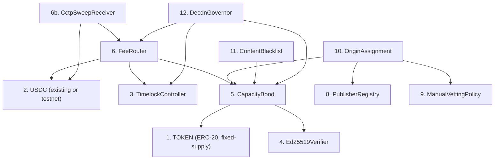
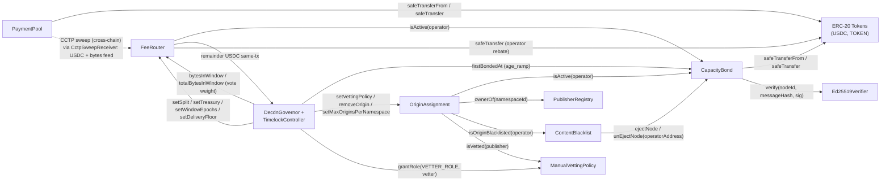
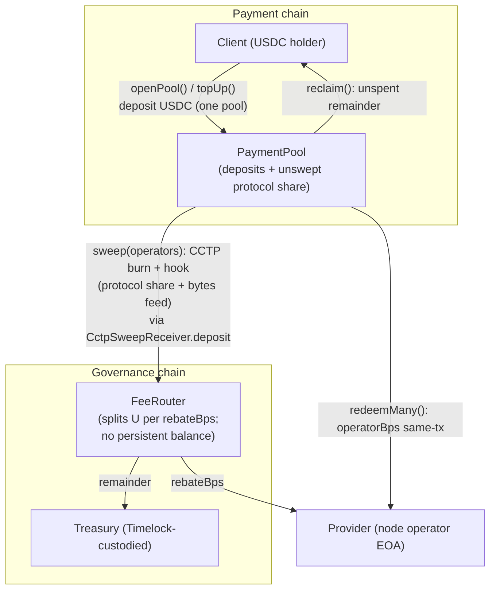
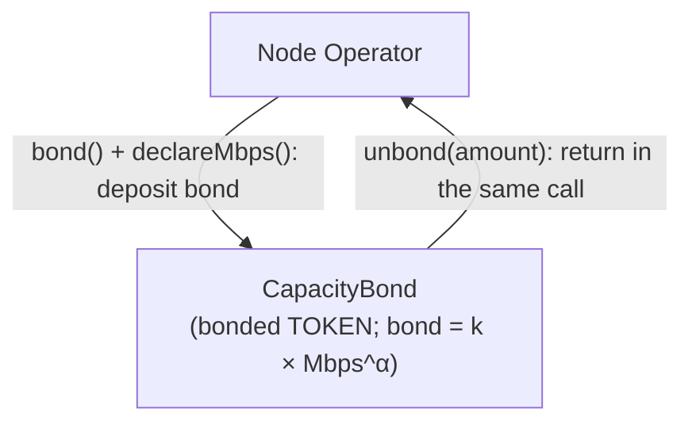

# ADR 016: Smart Contract Interaction Model

**Date:** 2026-05-27
**Status:** Draft

## Context

The deCDN deploys multiple interacting smart contracts with cross-contract calls, role-based access control, and funds custody. Individual contracts are specified across [ADR 003](003-payments.md#adr-003-payment-model), [ADR 009](009-governance.md#adr-009-governance-model), [ADR 011](011-content-takedown.md#adr-011-content-takedown-and-hash-blacklisting), and [ADR 026](026-tokenomics.md#adr-026-tokenomics). However, no single document maps the full interaction surface: who calls whom, which contracts hold funds, who is authorized to do what, and where reentrancy risks exist.

This ADR consolidates that analysis into a single reference for security audits and implementation. It does not introduce new functionality — it systematizes what other ADRs already specify.

> **[ADR 026](026-tokenomics.md#adr-026-tokenomics) driver.** `FeeRouter` is the governance-chain receiver of payment-chain sweeps; `CapacityBond` is the operator-registry contract (capacity-bond curve, NodeId binding). Read [ADR 026](026-tokenomics.md#adr-026-tokenomics) first for the economic model; this ADR is the integration view.

## Decision

### Deployment Tiers

The contracts run on two kinds of chain.

- **Governance chain.** Ethereum L1. It holds TOKEN, the bond, governance, and the treasury.
- **Payment chain.** Any EVM chain with native 6-decimal USDC and Circle CCTP V2 with hooks. It holds only `PaymentPool` and USDC. Many payment chains run at the same time.

| Chain | Contracts |
| --- | --- |
| Governance chain | `Token`, `CapacityBond`, `Ed25519Verifier`, `ContentBlacklist`, `OriginAssignment`, `PublisherRegistry`, vetting policies, `DecdnGovernor`, `TimelockController`, `FeeRouter`, `CctpSweepReceiver` |
| Payment chain | `PaymentPool` |

Two interfaces cross between the tiers. Both ride in one message.

1. **The sweep.** A bridge message from a payment chain to the governance chain. It carries the protocol share (USDC).
2. **The bytes feed.** The served-bytes records `(operator, bytes, amount)` in the sweep's payload, one per operator in the batch. There is no other bytes path.

`PaymentPool.sweep(operators[])` sends one sweep for up to `MAX_SWEEP_BATCH` (32) operators. A bridge adapter on the governance chain receives it and calls `FeeRouter.deposit(operator, bytes, amount)` once per operator, with that operator's part of the USDC that arrived ([§ Bridge adapters](#bridge-adapters)). The protocol share is the part of each redemption that is not paid to the operator on the payment chain.

#### Bridge adapters

`FeeRouter` knows no bridge. Its one entry point, `deposit`, pulls USDC from the caller and credits the named operator. Anyone may call it. The credit is priced on USDC that stays with the protocol ([§ Contract: FeeRouter](#contract-feerouter)), so the caller and the source of the USDC do not matter.

A bridge adapter is a stateless governance-chain contract with no roles. It speaks one bridge's receive interface, measures the USDC that arrived, and calls `deposit` for each operator in the batch. The reference deployment has one adapter, `CctpSweepReceiver`, for CCTP V2. Each `PaymentPool` deployment names its adapter and bridge as immutables.

**Batch payload.** The sweep payload is `abi.encode(SweepShare[])`. Each `SweepShare` is `(address operator, uint256 servedBytes, uint256 amount)`, in `sweep` input order. `amount` is the operator's pending USDC on the payment chain. The adapter splits the USDC that arrived, `U`, pro rata to the entry amounts: entry `i` gets `U × amount_i / Σ amount`, rounded down. The last entry gets the remainder, so the deposits sum to `U`. A bridge fee therefore comes out of every share alike. The adapter skips an entry whose part is 0, because `deposit` rejects a zero amount and one dust entry must not block the message. The adapter rejects an empty payload, a payload longer than `MAX_SWEEP_BATCH`, and a payload whose amounts sum to 0.

**Batch limit.** `MAX_SWEEP_BATCH` is 32. A full batch's CCTP burn body is 3364 bytes. The deployed `MessageTransmitterV2` on Ethereum and on Arbitrum Sepolia accepts a body of at most 8192 bytes (`maxMessageBodySize`). The governance-chain receive costs about 93k gas per operator with the real `FeeRouter` and cold storage, so a full batch adds about 3M gas to the CCTP receive. That is a small fraction of an Ethereum block.

To add a bridge, deploy a new adapter on the governance chain and a `PaymentPool` variant for that bridge on the payment chain. `FeeRouter` does not change, and no governance action is needed. Every `PaymentPool` variant shares one base and one external interface (`openPool`, `topUp`, `redeemMany`, `pending`, `sweep`, `closePool`, `reclaim`). Only the bridge call inside `sweep` differs.

A chain becomes a payment chain when it meets the rule in [the admission appendix](appendix-l2-deployment.md#appendix-governance-chain-and-payment-chain-admission). No per-chain list lives in this ADR.

The payment side has no governance. Every `PaymentPool` parameter is a constructor argument and is immutable. A `PaymentPool` reads no `CapacityBond` state. Governance tunes payment chains only through the split and the bytes weight on the governance-chain `FeeRouter` ([§ Tunable Economics](#tunable-economics)).

### Contract Inventory

deCDN contracts use audited [OpenZeppelin Contracts](https://docs.openzeppelin.com/contracts/) components where applicable, to minimize custom security-critical code. The `OZ Base Contracts` column below records what each contract inherits. `Ed25519Verifier` is the one exception in this table: it is a stateless `view` verifier that holds no storage, no funds, and no roles, so no OZ base contract applies. The full surface ships in a single audit pass. The split of each sweep is governance-tunable from day one (see [§ Tunable Economics](#tunable-economics) below).

| Contract | Deploys on | ADR | Holds Funds | Token Types | OZ Base Contracts |
| --- | --- | --- | --- | --- | --- |
| TOKEN (ERC-20) | Governance chain | [026](026-tokenomics.md#adr-026-tokenomics) | No (fungible token) | — | `ERC20`, `ERC20Permit` (fixed-supply per [ADR 026 § Supply and distribution](026-tokenomics.md#supply-and-distribution); no post-genesis mint function; `ERC20Votes` is intentionally omitted because Governor vote weight is derived from `FeeRouter` epoch accounting, not from per-account checkpoint structures, per [ADR 036](036-served-bytes-voting-weight.md#adr-036-served-bytes-voting-weight), so the per-transfer checkpoint cost is not earned) |
| CapacityBond | Governance chain | [003](003-payments.md#adr-003-payment-model), [026](026-tokenomics.md#adr-026-tokenomics) | Yes | TOKEN | `AccessControl`, `ReentrancyGuard`, `Pausable` (operator-registry contract. Exposes the lock-to-capacity curve `bond = k × Mbps^α` per [ADR 026 § Capacity-bond curve](026-tokenomics.md#capacity-bond-curve), `isActive(operator)` per [ADR 003](003-payments.md#adr-003-payment-model) `ICapacityBond`, `declaredMbps(operator)` for capacity-tier checks, `firstBondedAt(operator)` for the `age_ramp` source on `DecdnGovernor` per [ADR 036](036-served-bytes-voting-weight.md#adr-036-served-bytes-voting-weight), and `bindNodeId` / `reclaimNodeId` for the NodeId↔Ethereum-address binding) |
| PaymentPool | Payment chain | [003](003-payments.md#adr-003-payment-model) | Yes | USDC | `ReentrancyGuard`, `EIP712`, `SunsettingPausable` with an immutable `pauser` (USDC-only; the USDC address is fixed at deployment; one funded pool backs many capped signers to many nodes; no bond read, no governance, no roles; `redeemMany` pays `operatorBps` to the operator and accrues the protocol share in `pending`; `sweep(operators[])` sends a batch of up to 32 shares over CCTP to `CctpSweepReceiver` in one transfer) |
| FeeRouter | Governance chain | [026](026-tokenomics.md#adr-026-tokenomics) | Yes (within the `deposit` transaction only) | USDC (rebate and treasury legs transfer in the same transaction) | `AccessControl`, `ReentrancyGuard`, `Pausable` (`deposit` pulls USDC from any caller, splits it into rebate / treasury per [ADR 026 § FeeRouter split](026-tokenomics.md#feerouter-split), and keeps the served-bytes ledger) |
| CctpSweepReceiver | Governance chain | [016](#bridge-adapters) | Yes (within the receive transaction only) | USDC | `ReentrancyGuard` (stateless CCTP V2 adapter: `receiveSweep(message, attestation)` receives one sweep and calls `FeeRouter.deposit` once per operator in it; no roles, no setters) |
| ContentBlacklist | Governance chain | [011](011-content-takedown.md#adr-011-content-takedown-and-hash-blacklisting) | No | — | `AccessControl`, `ReentrancyGuard` — not `Pausable`, because the unlawful-content-removal duty is permanent and must survive the pause sunset ([§ Emergency Multisig](#emergency-multisig-production)) (full surface: hash-level — global + regional — operator-level — `addOperator` / `removeOperator` — origin-level — `isOriginBlacklisted` / `setOriginBlacklist` — plus the enumeration views `getScopeRegions` / `blacklistedHashCount` / `blacklistedHashes` / `blacklistedAddressCount` / `blacklistedAddresses` that let the compliance layer build blacklist state without replaying takedown events, and the append-only mutation ledger views `mutationCount` / `getMutations` (one record per state change an authorised caller makes) that a node polls by `eth_call` to follow every later change; see [ADR 011 § Following the mutation ledger](011-content-takedown.md#following-the-mutation-ledger)) |
| PublisherRegistry | Governance chain | [002](002-content-addressing.md#adr-002-content-addressing) | No | — | `AccessControl` (no `ReentrancyGuard`: the contract makes no external calls and holds no funds, so a reentrancy guard would be dead weight — every function is pure storage bookkeeping) |
| OriginAssignment | Governance chain | [011](011-content-takedown.md#adr-011-content-takedown-and-hash-blacklisting) | No | — | `AccessControl`, `ReentrancyGuard` (delegates the vetting decision to a swappable `IVettingPolicy` set via `setVettingPolicy`; `addOrigin` reads `vettingPolicy.isVetted(msg.sender)`) |
| ManualVettingPolicy | Governance chain | [011](011-content-takedown.md#adr-011-content-takedown-and-hash-blacklisting) | No | — | `AccessControl` (the genesis `IVettingPolicy`: a `VETTER_ROLE` holder approves publishers via `setVetted`; `VETTER_ROLE`'s admin is `GOVERNANCE_ROLE`, so governance moves *who* vets without a contract swap. Alternative policies — `OpenVettingPolicy` (testnet-only) or a future attestation policy — implement the same one-function seam and are installed by `OriginAssignment.setVettingPolicy`. No `ReentrancyGuard`: pure storage bookkeeping, no external calls) |
| Ed25519Verifier | Governance chain | [003](003-payments.md#nodeid-ownership-verification), [019](019-node-onboarding.md#adr-019-node-onboarding-and-bootstrapping-flow) | No | — | None — a stateless `view` verifier behind the frozen `IEd25519Verifier` interface. It holds no storage, no funds, and no roles, so no OZ base contract applies. It performs the RFC 8032 PureEdDSA check that `CapacityBond` runs on the NodeId ownership proof in `registerNode`, `bindNodeId`, and `reclaimNodeId`. The contract delegates the core group check to the audited Smoo.th Crypto Lib EIP-6565 routine and adds the public-key decompression plus the strict guards — reject small-order points, non-canonical `y`, off-curve keys. [ADR 003 § On-chain verification](003-payments.md#on-chain-verification) covers why parity with `ed25519-dalek::verify_strict` is the security bar |
| DecdnGovernor | Governance chain | [009](009-governance.md#adr-009-governance-model), [036](036-served-bytes-voting-weight.md#adr-036-served-bytes-voting-weight) | No | — | OZ `Governor` + `GovernorCountingSimple` + `GovernorTimelockControl` with a custom served-bytes vote source: reads `FeeRouter.bytesInWindow(operator, epoch(ts), windowEpochs)` and `FeeRouter.totalBytesInWindow(epoch(ts), windowEpochs)` for the bytes-weighted weight basis, and `CapacityBond.firstBondedAt(operator)` for the tenure ramp per [ADR 036 § Formula](036-served-bytes-voting-weight.md#formula). Vote weight is derived from FeeRouter epoch accounting, not per-account checkpoints, so OZ's `GovernorVotes` / `GovernorVotesQuorumFraction` are not used. Thin wrapper supplying fixed deCDN defaults: timestamp clock, 1-day voting delay, 7-day vote, 0.1% proposal threshold, 4% quorum, 10% per-operator voting cap (launch value, decrease-only, applied against bytes-weighted total). EIP-712 delegation per Governor Bravo (voting power delegable, bond non-delegable) per [ADR 026 § Governance](026-tokenomics.md#governance). |
| TimelockController | Governance chain | [009](009-governance.md#adr-009-governance-model) | Yes (treasury custodian) | USDC | OZ `TimelockController` (no custom code; 48h delay; holds the treasury remainder of each sweep per [ADR 026 § FeeRouter split](026-tokenomics.md#feerouter-split) and holds `GOVERNANCE_ROLE` on every contract above; `DEFAULT_ADMIN_ROLE` is renounced to no one at deploy end so no master admin key survives — see [§ Access Control Matrix](#access-control-matrix)) |

#### Contract Architecture (classDiagram)

The diagram below shows the full contract surface and its primary call relationships. `PaymentPool` lives on a payment chain; every other contract lives on the governance chain. `FeeRouter` is the canonical served-bytes accountant; `Governor` reads `bytesInWindow` and `totalBytesInWindow` from it as the voting-weight basis per [ADR 036](036-served-bytes-voting-weight.md#adr-036-served-bytes-voting-weight), and reads `firstBondedAt` from `CapacityBond` for the tenure ramp. `CapacityBond` is the operator-registry contract. There is no separate emissions contract.

```mermaid
classDiagram
    class PaymentPool {
        +openPool(deposit)
        +redeemMany(batches) : voucher + optional chain preimage
        +sweep(operators)
        +closePool(poolId)
        +reclaim(poolId)
        immutables : usdc, tokenMessenger, sweepRecipient, sweepDomain, disputeWindow, operatorBps, minSweep, minDeposit, pauser
    }
    class CctpSweepReceiver {
        +receiveSweep(message, attestation)
    }
    class FeeRouter {
        +deposit(operator, bytes, amount)
        +bytesPerEpoch(op, epoch)
        +totalBytesPerEpoch(epoch)
        +bytesInWindow(op, endEpoch, N)
        +totalBytesInWindow(endEpoch, N)
        +windowEpochs()
        +setWindowEpochs(n)
        +setSplit(rebateBps)
    }
    class CapacityBond {
        +bond(amount)
        +declareMbps(mbps)
        +registerNode(nodeId, ...)
        +unbond(amount)
        +declaredMbps(op)
        +firstBondedAt(op)
    }
    class Governor {
        +propose()
        +vote()
        +execute()
    }
    class Treasury

    PaymentPool ..> CctpSweepReceiver : CCTP sweep (cross-chain: USDC + bytes feed)
    CctpSweepReceiver ..> FeeRouter : deposit(operator, bytes, amount)
    FeeRouter ..> CapacityBond : isActive / declaredMbps
    FeeRouter ..> Treasury : remainder USDC (same-tx)
    Governor ..> FeeRouter : bytesInWindow / totalBytesInWindow (voting weight)
    Governor ..> CapacityBond : firstBondedAt (age_ramp)
```

The split of each sweep is specified in [ADR 026 § FeeRouter split](026-tokenomics.md#feerouter-split). All legs transfer in the receive transaction. This ADR does not duplicate the split table; the tunability mechanism is in [§ Tunable Economics](#tunable-economics) below.

#### Tunable Economics

Every knob is a governance-chain parameter on `FeeRouter`, under `GOVERNANCE_ROLE` (the `TimelockController`). A payment chain has no knob.

| Knob | Meaning |
| --- | --- |
| `rebateBps` | Share of each sweep's minted USDC `U` that returns to the operator. |
| `treasury` | Treasury address (the `TimelockController`). It receives the remainder of `U`. |
| `windowEpochs` | Trailing-window length of the served-bytes vote weight. Bounds 4-26 per [ADR 036 § Governable parameters](036-served-bytes-voting-weight.md#governable-parameters-with-safety-bounds). |
| `deliveryFloor` | Treasury-leg USDC micro-units per MiB of weight credit. Bounds 1-1000, launch value 1. |

The split has two legs: the rebate to the operator and the remainder to the treasury. `setSplit(rebateBps)` sets the rebate. The treasury takes the rest. `rebateBps` is at most 9900, so the treasury keeps at least 1% of each deposit (see **Treasury share floor** below). The constructor and `setTreasury` reject a zero treasury address.

**Operator share.** The operator receives `operatorBps` (immutable on the payment chain, 6000 in the reference deployment) at redemption, plus the rebate part of the protocol share. The launch value is `rebateBps` 7500. It gives the operator 60% + 30% = 90% and the treasury 10%. The standard 48h timelock makes each split change observable in advance.

**Treasury share floor.** Weight credit is backed only by the treasury leg of a deposit. With a zero treasury leg, no deposit credits weight. The trailing window then empties, and no one holds the votes to change the split back. So `setSplit` rejects a `rebateBps` above 9900 (`RebateAboveCeiling`). Every deposit keeps at least a 1% treasury leg, and a direct deposit can always restore weight ([ADR 036 § Behaviors that follow from the formula](036-served-bytes-voting-weight.md#behaviors-that-follow-from-the-formula)).

`PaymentPool` has no tunable. Its `minDeposit` (dormant at 0, see [ADR 003 § Minimum deposit](003-payments.md#minimum-deposit)) is an immutable.

#### Contract: FeeRouter

```solidity
interface IFeeRouter {
    // Pulls `amount` USDC (`U`) from `msg.sender` and credits `bytes` to
    // `operator`. Permissionless: any caller, any bridge adapter, any
    // pool. There is no pool or adapter allowlist.
    //   1. Active at arrival: the rebate and the weight credit go to the
    //      operator only if `CapacityBond.isActive(operator)`. Otherwise
    //      the rebate goes to the treasury and the credit is 0.
    //   2. USDC-backed credit: `credit = min(bytes, treasuryLeg * 1 MiB /
    //      deliveryFloor)`, where `treasuryLeg` is the USDC that goes to
    //      the treasury (not the rebate).
    //   3. Capacity clamp: the credit cannot exceed `CapacityBond.
    //      declaredMbps(operator) * EPOCH_LENGTH * 125_000` minus what
    //      `bytesPerEpoch[operator][epoch]` already holds. The clamp binds
    //      the operator counter and the network total alike.
    //   4. Arrival-epoch stamping: the credit is written to
    //      `epoch = uint64(block.timestamp / EPOCH_LENGTH)`, so a late
    //      sweep never changes a closed epoch.
    // Split of `U`: `rebateBps` to the operator, the remainder to the
    // treasury. A failed rebate transfer falls back to the treasury.
    // Reverts if paused.
    function deposit(address operator, uint256 bytes, uint256 amount) external;

    // Per-operator, per-epoch served bytes — written by
    // deposit. The governance vote-weight source per ADR 036:
    // DecdnGovernor sums this counter over the trailing `windowEpochs`
    // epochs via `bytesInWindow` to derive an operator's served-bytes
    // weight. Also used off-chain for dashboards.
    function bytesPerEpoch(address operator, uint64 epoch) external view returns (uint256);

    // Global per-epoch served bytes — written by
    // deposit alongside `bytesPerEpoch`. Used by DecdnGovernor
    // via `totalBytesInWindow` for the bytes-weighted total in the
    // per-operator vote cap, quorum, and proposal-threshold checks per
    // ADR 036.
    function totalBytesPerEpoch(uint64 epoch) external view returns (uint256);

    // Trailing-window helpers consumed by DecdnGovernor's `_getVotes`
    // and quorum / proposalThreshold paths per ADR 036 § Formula. Each
    // performs an O(N) loop of cold SLOADs across the requested window.
    // `endEpoch` is the inclusive last epoch in the sum, typically
    // `uint64(proposalSnapshot / EPOCH_LENGTH)`.
    function bytesInWindow(
        address operator,
        uint64 endEpoch,
        uint64 N
    ) external view returns (uint256);

    function totalBytesInWindow(
        uint64 endEpoch,
        uint64 N
    ) external view returns (uint256);

    // Governance-mutable trailing-window length (default 13, bounded
    // [4, 26] per ADR 036 § Governable parameters). Stored on FeeRouter
    // as the single source of truth for the window length DecdnGovernor
    // reads from.
    function windowEpochs() external view returns (uint64);
    function setWindowEpochs(uint64 n) external;

    // Governance-set state ([§ Tunable Economics](#tunable-economics)).
    function rebateBps() external view returns (uint256);
    function treasury() external view returns (address);
    function deliveryFloor() external view returns (uint256);
    function epochLength() external view returns (uint64);

    // `setSplit` sets the rebate (at most 9900). The treasury takes the
    // remainder. `setTreasury` rejects the zero address.
    function setSplit(uint256 rebateBps) external;
    function setTreasury(address newTreasury) external;
    function setDeliveryFloor(uint256 newFloor) external;

    // `pause()` blocks `deposit`. A bridge message that cannot deposit
    // stays unreceived and valid until unpause.
    function pause() external;
    function unpause() external;

    // ─── Events ───────────────────────────────────────────────────────
    // `epoch` is `uint64(block.timestamp / EPOCH_LENGTH)` at arrival.
    event Deposited(
        address indexed depositor,
        address indexed operator,
        uint256 amount,
        uint256 bytes,
        uint256 credit,
        uint64 indexed epoch
    );
    event SplitUpdated(uint256 rebateBps);
    event DeliveryFloorUpdated(uint256 oldValue, uint256 newValue);
    event TreasuryUpdated(address indexed oldAddr, address indexed newAddr);
    event WindowEpochsUpdated(uint64 oldValue, uint64 newValue);
}
```

**Notes:**

- **Epoch length is immutable** (1 week, constructor-set, the one `EPOCH_LENGTH` shared with `CapacityBond` on the same chain; [ADR 026 § FeeRouter split](026-tokenomics.md#feerouter-split)). `bytesPerEpoch` and `totalBytesPerEpoch` are governance-canonical because `DecdnGovernor` derives served-bytes vote weight from them per [ADR 036](036-served-bytes-voting-weight.md#adr-036-served-bytes-voting-weight). A `FeeRouter` migration resets the vote-weight history until traffic refills the trailing window ([ADR 036 § Consequences > Negative](036-served-bytes-voting-weight.md#negative)).
- **`bytesPerEpoch` and `totalBytesPerEpoch` are the governance vote-weight source.** `DecdnGovernor._getVotes` calls `bytesInWindow(operator, endEpoch, windowEpochs)` and `totalBytesInWindow(endEpoch, windowEpochs)` for the per-operator weight and the cap denominator. `DecdnGovernor` takes the `FeeRouter` address as its constructor argument and reads the same interface as before.
- **Wash-trading defense.** The credit is priced on USDC that stays with the protocol. A pool with a low or zero protocol share earns little or no weight, and forged weight costs real USDC at a price set on the governance chain. The credit never exceeds `bytes`, so an over-declared tier does not translate into governance influence. Because `deposit` is open, any party can also fill an operator's capacity clamp for an epoch with bytes it pays for. That empties the operator's remaining weight credit for that epoch. Its cost is the clamp times `deliveryFloor`, plus the rebate it gives the operator. Governance prices this through `deliveryFloor`. The same open `deposit` restores vote weight after a window with no sweeps: active operators deposit USDC directly on the governance chain ([ADR 036 § Behaviors that follow from the formula](036-served-bytes-voting-weight.md#behaviors-that-follow-from-the-formula)).
- **`CctpSweepReceiver`.** The CCTP V2 adapter ([§ Bridge adapters](#bridge-adapters)). `receiveSweep(message, attestation)` is permissionless. Each sweep sets the receiver as `mintRecipient` and `destinationCaller`, so only the receiver can call `MessageTransmitterV2.receiveMessage` for it. The receiver accepts a message only if the outer `recipient` is the local `TokenMessengerV2` and the burn body's `mintRecipient` is the receiver. These checks reject a generic CCTP message that only names the receiver as `destinationCaller`. The messenger itself accepts a burn message only from its `remoteTokenMessengers(sourceDomain)`. `U` is the rise in the receiver's USDC balance across `receiveMessage`, so a burn of any other token mints no USDC and credits nothing. The receiver decodes `hookData = abi.encode(SweepShare[])` and calls `FeeRouter.deposit(operator, bytes, share)` for each entry, with `U` split pro rata ([§ Bridge adapters](#bridge-adapters)). A standard-transfer message carries no expiration block, and CCTP nonce tracking makes each sweep land once. While `FeeRouter` is paused, `receiveSweep` reverts and the message stays valid. The receiver emits `SweepReceived(sourceDomain, pool, operator, amount)` for each deposited entry, where `pool` is the burn body's `messageSender`. The operator completes its sweeps with `decdn node receive-sweeps`. The command finds each batch that carries the operator's share, gets the batch message and its attestation from Circle's attestation service once, and calls `receiveSweep` once per message. It skips a message whose nonce the `MessageTransmitterV2` marks as used. No daemon task receives sweeps.
- **No `initialize(...)` helper.** Proxies are forbidden ([§ No proxy deployment patterns](#no-proxy-deployment-patterns)). The constructor plus post-deploy setters from `TimelockController` suffice.

##### Interface: PaymentPool (payment chain)

```solidity
interface IPaymentPool {
    // Pays `operatorBps` of each paid amount to `msg.sender` in the same
    // transaction. The rest accrues in `pending[msg.sender]` as
    // `(bytes, usdc)`. The pool does not clamp bytes.
    function redeemMany(Batch[] calldata batches) external;

    // Permissionless. Takes 1 to MAX_SWEEP_BATCH (32) operators, each with
    // a non-zero `pending[operator].usdc`; a repeated operator reads zero
    // after its first entry and reverts. Needs the batch total to be at
    // least `minSweep`. Resets each `pending[operator]` and emits
    // `Swept(operator, bytes, usdc)` per operator, then calls CCTP V2
    // `depositForBurnWithHook` once for the total (`minFinalityThreshold`
    // 2000) with `mintRecipient` and `destinationCaller` set to
    // `sweepRecipient` (the governance-chain `CctpSweepReceiver`),
    // `maxFee = getMinFeeAmount(total)` (0 when the messenger has no such
    // function), and `hookData = abi.encode(SweepShare[])`. Emits
    // `SweepSent(total, maxFee)`. The operator has its own reason to
    // sweep: the sweep carries its rebate and its vote weight.
    function sweep(address[] calldata operators) external;

    function pending(address operator) external view returns (uint256 bytes_, uint256 usdc);

    // Immutables: usdc, tokenMessenger, sweepRecipient, sweepDomain
    // (Ethereum is domain 0), disputeWindow, operatorBps, minSweep,
    // minDeposit, pauser. Each has a public getter.
}
```

`PaymentPool` has no `capacityBond`, no `FeeRouter` reference, no roles, and no governance. `disputeWindow` exceeds the chain's censorship window. The pool holds deposits plus the unswept protocol share, which `pending` tracks. `pause()` by the immutable `pauser` blocks `openPool` and `topUp`. `redeemMany` and `sweep` never pause. [ADR 003](003-payments.md#adr-003-payment-model) specifies the payment model.

##### No proxy deployment patterns

No deCDN contract uses proxy (upgradeable) deployment patterns. Production contract upgrades deploy new contracts at new addresses with state migration. This constraint ensures that EIP-712 domain separators computed in constructors (as `immutable`) remain valid for the contract's lifetime. A proxy migration to a different address or chain would invalidate all existing voucher signatures.

Payment-side contracts are not upgradeable and have no admin. Their domain binds the payment chain id and the pool address.

**Carve-out for non-signing helper addresses.** The immutability constraint applies only to the addresses that name an EIP-712 domain: `PaymentPool` (vouchers) and `CapacityBond` (the off-chain `StreamResponse`, `OriginAttestation` and client-binding signatures per [ADR 005 § Signer binding](005-protocol.md#signer-binding)). Some helper-contract addresses, such as the `setTreasury` setter on `FeeRouter`, may be re-pointed via `GOVERNANCE_ROLE`-gated setters under the standard 48h timelock. Helper addresses are not domain-separator inputs, so re-pointing them invalidates no signature.

**Build toolchain:** [Foundry](https://book.getfoundry.sh/) (forge, cast, anvil) for compilation, testing, and deployment.

#### Contract: CapacityBond

`CapacityBond` is the operator-registry contract: voluntary TOKEN bond on the capacity-bond curve, NodeId binding, and the `firstBondedAt` read consumed by `DecdnGovernor`. There is no on-chain operator-credit grant/vest surface. The bond is the operator's own TOKEN (`activeBond(op)`). `unbond(amount)` returns it to the operator in the same call, down to `bondRequired(declaredMbps)`. The full surface (`bond`, `unbond`, `declareMbps`, `registerNode`, `deregisterNode`, `firstBondedAt`, `activeBond`, `bindNodeId` / `reclaimNodeId`, `ejectNode` / `unEjectNode`, `isActive`) is covered in [§ Contract Inventory](#contract-inventory), [§ Contract Architecture](#contract-architecture-classdiagram), [§ Cross-Contract Call Graph](#cross-contract-call-graph), and [§ Off-Chain Read API](#off-chain-read-api-client--node-bootstrap).

##### Operator-terms acceptance

`CapacityBond` holds `currentTermsHash`, the governance-canonical hash of the operator terms, and enforces it at registration. `registerNode` takes a `termsHash` argument and reverts `TermsHashMismatch(provided, expected)` unless it equals `currentTermsHash`. The EIP-712 registration signature covers `termsHash`, so one signature carries both the NodeId binding and the operator's assent, and a successful registration emits `TermsAccepted(nodeId, termsHash, timestamp)` as the on-chain record. [ADR 019 § Operator Safety Obligations](019-node-onboarding.md#operator-safety-obligations) specifies what the terms contain and what the record does and does not evidence.

The hash is a governance parameter with two write paths, and both reject the zero sentinel (`ZeroTermsHash`):

- **At construction.** The genesis hash is a constructor argument (step 5 of [§ Constructor Dependencies](#constructor-dependencies)). Because the zero value reverts, a deployment cannot land with terms enforcement switched off.
- **Post-deployment.** `setCurrentTermsHash(bytes32)` is `GOVERNANCE_ROLE`-gated, so a terms revision passes through `DecdnGovernor` and the standard 48h timelock like every other parameter change. It emits `CurrentTermsHashUpdated(oldHash, newHash)`. There is no privileged owner path and no contract migration.

The parameter carries no `[floor, ceiling]` safety rail, because a hash has no monotonic direction to bound. The rail is instead a governance norm, which [ADR 019 § Operator Safety Obligations](019-node-onboarding.md#operator-safety-obligations) specifies. Enforcement is evaluated at registration only. A later bump binds new registrants. It does not narrow what an already-registered operator owes: the `TermsAccepted` record fixes the version a node assented to, not the ceiling of what governance may enforce.

### Deployment Order and Initialization Dependencies

Each tier has its own deployment order. Each contract's constructor requires the addresses of contracts deployed before it. The step numbers give the constructor dependency order, not the wall-clock order of the deploy script (`contracts/script/BaseProtocolDeploy.s.sol`). For example, the script deploys the `TimelockController` before TOKEN, because TOKEN deploys with the other targets and USDC is an external input.

**Governance chain.**



**Payment chain.** `PaymentPool` (step 7 below) is the only contract. It needs only USDC, the CCTP token messenger, the `CctpSweepReceiver` address and CCTP domain, and its constants. It deploys after `CctpSweepReceiver` because it takes the receiver's address. It needs no role grant and no other contract.

#### Constructor Dependencies

| Step | Contract | Constructor Requires |
| --- | --- | --- |
| 1 | TOKEN | Initial holder, initial supply (1B fixed per [ADR 026](026-tokenomics.md#adr-026-tokenomics) [§ Supply and distribution](026-tokenomics.md#supply-and-distribution)), owner. No `mint()` function; testnet seeding happens via the constructor `_mint(initialHolder, 1_000_000_000e18)`. |
| 2 | USDC | External (testnet faucet or mainnet address) |
| 3 | TimelockController | OZ `TimelockController(minDelay, proposers, executors, admin)` — `minDelay` is 48h ([ADR 009](009-governance.md#adr-009-governance-model)). Deployed early so its address is available to `FeeRouter` as the treasury destination and to every `AccessControl`-bearing contract as the eventual `GOVERNANCE_ROLE` holder (`DEFAULT_ADMIN_ROLE` is renounced to no one at deploy end, not handed to the Timelock — see [§ Access Control Matrix](#access-control-matrix)). `proposers` is initialized empty and `PROPOSER_ROLE` is granted post-deploy (step 12) — to `DecdnGovernor` by default, or to the bootstrap multisig instead during the [ADR 009 § Bootstrap-multisig phase](009-governance.md#bootstrap-multisig-phase); `executors` is `[address(0)]` (anyone may execute after the delay). |
| 4 | Ed25519Verifier | None. The verifier is stateless and takes no constructor arguments; the deploy links the Smoo.th Crypto Lib EIP-6565 library into it. It must exist before `CapacityBond`, whose constructor takes its address and rejects the zero address (`ZeroAddress`). A later verifier revision deploys as a fresh contract, so a `CapacityBond` that adopts it deploys fresh too — the address is a constructor immutable, not a setter (see [ADR 003 § NodeId Ownership Verification](003-payments.md#nodeid-ownership-verification)). |
| 5 | CapacityBond | TOKEN address, Ed25519Verifier address, admin address, `minBond`, `multiaddrUpdateCooldown`, `maxMultiaddrSize`, `regionStabilityWindow`, `currentTermsHash`. The TOKEN, verifier, and admin addresses are rejected as zero, and each numeric parameter is bounds-checked in the constructor with the same rail its governance setter enforces. `currentTermsHash` is the genesis operator-terms hash new registrants must accept per [§ Operator-terms acceptance](#operator-terms-acceptance) below; the constructor rejects the zero sentinel (`ZeroTermsHash`), so a terms-disabled deployment is not reachable. The capacity-curve coefficients (`kConstant`/`alphaWad`; defaults `k=12.6`, `α=1.2`) and the declared-capacity band (`minCapacityMbps`/`maxCapacityMbps`; defaults 10 Mbps / 200 Gbps) per [ADR 026 § Capacity-bond curve](026-tokenomics.md#capacity-bond-curve) are **not** constructor arguments — they are storage initialized to these defaults in the constructor and governance-tunable post-deploy via `setK` / `setAlpha` / `setMinCapacityMbps` / `setMaxCapacityMbps`. `age_ramp_months` is **not** a `CapacityBond` parameter at all; it lives on `DecdnGovernor` (`setAgeRampMonths`, step 12). Exposes `bindNodeId` / `reclaimNodeId` for NodeId rebinding. |
| 6 | FeeRouter | USDC address, **CapacityBond address**, **`TimelockController` address** (treasury destination), `epochLength` (1 week; the canonical served-bytes voting-weight clock per [ADR 036](036-served-bytes-voting-weight.md#adr-036-served-bytes-voting-weight)), `windowEpochs` (initial trailing-window length, default 13, bounds-checked `[4, 26]` per [ADR 036 § Governable parameters](036-served-bytes-voting-weight.md#governable-parameters-with-safety-bounds)), `deliveryFloor` (bounds-checked `[1, 1000]`), admin address, launch `rebateBps` (at most 9900). The USDC, CapacityBond, treasury, and admin addresses are rejected as zero, and `epochLength` is rejected as zero. See [§ FeeRouter construction notes](#feerouter-construction-notes). |
| 6b | CctpSweepReceiver | USDC address, local CCTP `MessageTransmitterV2` and `TokenMessengerV2` addresses, FeeRouter address. All are rejected as zero. No admin, no roles. See [§ Bridge adapters](#bridge-adapters). |
| 7 (payment chain) | PaymentPool | USDC address, CCTP `tokenMessenger`, the governance-chain `CctpSweepReceiver` address (`sweepRecipient`) and its CCTP domain (`sweepDomain`), `disputeWindow` (larger than the chain's censorship window; 48h in the reference deployment), `operatorBps` (6000 in the reference deployment), `minSweep`, `minDeposit` (0, dormant Sybil floor per [ADR 003 § Minimum deposit](003-payments.md#minimum-deposit)), `pauser` ([ADR 003](003-payments.md#adr-003-payment-model)). Every value is immutable. A pool is one deposit backing many capped signers to many nodes. |
| 8 | PublisherRegistry | None. Permissionless namespace creation (publisher identity is implicit on first call); namespace cap and ownership-transfer timelock are stored on `PublisherRegistry` itself and updated via governable setters (`setMaxNamespacesPerPublisher`, `setNamespaceTransferTimelock`) per [ADR 002 § Contract: PublisherRegistry](002-content-addressing.md#contract-publisherregistry). |
| 9 | ManualVettingPolicy | `ManualVettingPolicy(address admin, address initialVetter)`. The genesis `IVettingPolicy`. `admin` holds `DEFAULT_ADMIN_ROLE` + `GOVERNANCE_ROLE` at construction; the handoff hands `GOVERNANCE_ROLE` to the Timelock and renounces `DEFAULT_ADMIN_ROLE` to no one, like every target. `initialVetter` is seeded with `VETTER_ROLE`, whose admin is `GOVERNANCE_ROLE`. A production deploy rejects a zero `initialVetter` (`MissingInitialVetter`) — a network with no vetter can onboard no publisher, and served-bytes governance cannot start until data is published, so the deploy fails fast rather than shipping that deadlock. No other dependencies. Deployed just before `OriginAssignment`, which takes it as a constructor argument. See [ADR 011 § Vetting policies](011-content-takedown.md#vetting-policies). |
| 10 | OriginAssignment | CapacityBond, PublisherRegistry, and the vetting policy (`ManualVettingPolicy` at genesis; non-zero and required to be a contract, swappable via `setVettingPolicy`). No `ContentBlacklist` binding — the seat set is a routing hint and consumers filter against the blacklist themselves. The per-namespace origin cap is governance-controlled; vetting parameters, if any, live on the installed policy. See [ADR 011 § Origin Assignment Authority](011-content-takedown.md#origin-assignment-authority) and [§ OriginAssignment construction notes](#originassignment-construction-notes) below. |
| 11 | ContentBlacklist | `ContentBlacklist(ICapacityBondEjector capacityBond, address admin)`. Both are rejected as zero. The CapacityBond address is required for `ejectNode()`; the admin receives `DEFAULT_ADMIN_ROLE` + `GOVERNANCE_ROLE`. `ContentBlacklist` does not cross-call `OriginAssignment`, and `OriginAssignment` holds no `ContentBlacklist` binding; security relies on consumer runtime checks (see [ADR 011 § Interaction with ContentBlacklist](011-content-takedown.md#interaction-with-contentblacklist)). |
| 12 | DecdnGovernor | OZ Governor wrapper composing `Governor` + `GovernorCountingSimple` + `GovernorTimelockControl`, with a custom served-bytes vote source per [ADR 036 § Formula](036-served-bytes-voting-weight.md#formula) (`_getVotes` → `FeeRouter.bytesInWindow / totalBytesInWindow` capped, multiplied by `age_ramp(CapacityBond.firstBondedAt)`; `quorum` / `proposalThreshold` → `FeeRouter.totalBytesInWindow`). Constructor wires `FeeRouter` (bytes vote source, non-zero) + `CapacityBond` (tenure-ramp source, non-zero) + `TimelockController` (execution target) + the fixed [ADR 009](009-governance.md#adr-009-governance-model) defaults (timestamp clock, 1-day delay, 7-day vote, 0.1% proposal threshold, 4% quorum, 10% per-operator voting cap (launch value, decrease-only) applied against bytes-weighted total). EIP-712 delegation per Governor Bravo. After deployment, `TimelockController.grantRole(PROPOSER_ROLE, address(decdnGovernor))` (and `CANCELLER_ROLE`); execution is open (`executors == [address(0)]`, step 3). A deploy that opts into the [ADR 009 § Bootstrap-multisig phase](009-governance.md#bootstrap-multisig-phase) grants those two roles to the bootstrap multisig instead and leaves the Governor with neither, so it is deployed and vote-wired but cannot propose until the transition batch moves both roles to it. The Governor's constructor arguments are identical in both cases. |

#### FeeRouter construction notes

- **CapacityBond is a stored dependency.** `deposit` reads `CapacityBond.isActive(operator)` and `CapacityBond.declaredMbps(operator)` on each sweep. `FeeRouter` and `CapacityBond` share the one 7-day `EPOCH_LENGTH` on the same chain, so the declared-capacity cap per epoch and `FeeRouter.bytesPerEpoch` epochs line up ([ADR 036 § Formula](036-served-bytes-voting-weight.md#formula)). The constructor reverts `EpochLengthMismatch` if the two lengths differ.
- **Treasury from genesis.** The treasury is the `TimelockController` from step 3. The constructor rejects a zero treasury, so every deposit has a destination for its treasury leg.

#### OriginAssignment construction notes

- **Vetting policy binding.** `OriginAssignment` takes the vetting policy as a constructor argument and rejects `address(0)` — a concrete policy exists from genesis, with no permissive bootstrap window. The genesis policy is `ManualVettingPolicy` (deployed at step 9). Governance re-points it later with `setVettingPolicy` (see [ADR 011 § Vetting policies](011-content-takedown.md#vetting-policies)); the binding is a helper-address re-point, not a domain-separator input, so it carries the standard 48h timelock.
- **Namespace 0.** `namespaceId == 0` has no authorized origins: no set is seated for it, `getOrigins(0)` is empty, and `isAuthorizedOrigin(0, op)` is always false.
- **No ContentBlacklist binding.** `OriginAssignment` reads no blacklist. The seat set is a routing hint, and consumers of `getOrigins(...)` filter each operator against `ContentBlacklist.isOriginBlacklisted`/`isOperatorBlacklisted` themselves (see [ADR 011 § Interaction with ContentBlacklist](011-content-takedown.md#interaction-with-contentblacklist)). `pruneInactiveOrigin` reads only `CapacityBond.isActive`, so it needs no post-deploy wiring.

#### Post-Deployment Initialization

After all contracts are deployed, the deployer must execute these transactions before the system accepts user traffic:

1. **Grant `BLACKLIST_ROLE`** on CapacityBond to ContentBlacklist:

   ```solidity
   capacityBond.grantRole(BLACKLIST_ROLE, address(contentBlacklist));
   ```

2. **Register regional governance bodies** (when jurisdictional bodies are constituted):

   ```solidity
   contentBlacklist.registerRegionalBody(regionCode, bodyAddress, emergencyMultisig);
   ```

   The body is bound to `regionCode` and may only write entries for it. The third
   argument names the `EMERGENCY_MULTISIG_ROLE` holder to check signer
   disjointness against — see [ADR 011 § Signer non-overlap](011-content-takedown.md#regional-governance-bodies).
   The call reverts on overlap; where either side is not signer-enumerable it
   succeeds with `RegionalBodyRegistered.signersVerified == false`, and the
   proposal must document the off-chain disjointness check.

3. **Hand off governance and renounce the admin key.** Each `AccessControl`
   contract hands `GOVERNANCE_ROLE` to the `TimelockController`, then renounces
   `DEFAULT_ADMIN_ROLE` to no one:

   ```solidity
   // For each contract with AccessControl:
   contract.grantRole(GOVERNANCE_ROLE, address(timelockController));
   contract.revokeRole(GOVERNANCE_ROLE, deployer);
   contract.renounceRole(DEFAULT_ADMIN_ROLE, deployer); // last role op on this target
   ```

   `DEFAULT_ADMIN_ROLE` is the admin of every other role, so a holder can
   `grantRole(GOVERNANCE_ROLE, anyAddress)` and hand a fresh account the whole
   governance surface with no vote and no Timelock delay — the master-key bypass
   of every other hardening. Renouncing it (holding it nowhere, not even on the
   Timelock) freezes the role table: `GOVERNANCE_ROLE` and the contract-held peer
   roles can no longer be granted or rotated, so governance migration is a
   redeploy. The roles that genuinely need rotation, `PAUSER_ROLE` and
   `EMERGENCY_MULTISIG_ROLE`, are re-homed in each constructor to
   `GOVERNANCE_ROLE` admin, so a compromised off-chain key is still rotatable
   through a timelocked proposal. The deploy asserts no address holds
   `DEFAULT_ADMIN_ROLE` and that each rotatable role's admin is `GOVERNANCE_ROLE`.

> **Admin handover hardening:** the renounce is the last role operation on each
> target — once `DEFAULT_ADMIN_ROLE` has no holder, no admin-gated grant or revoke
> can succeed, so the `GOVERNANCE_ROLE` grant to the Timelock and its revoke from
> the deployer both precede it.

> **Deployment atomicity.** The post-deployment initialization steps (1–3) SHOULD be executed atomically via a multicall contract or a deployment script that reverts on any failure. A partially initialized system (e.g., `BLACKLIST_ROLE` granted but governance not yet handed off) could create a window where some security mechanisms work and others do not. The payment chain needs no initialization. Between deployment and initialization completion, `CapacityBond` SHOULD reject `bond` / `registerNode` calls (e.g., via a `paused` initial state or a deployment flag) to prevent nodes from registering before the security infrastructure is fully wired. A Foundry deployment script with sequential `vm.broadcast()` calls provides sufficient atomicity at launch scale.

### Cross-Contract Call Graph



#### Complete Call Table

| Caller | Callee | Function | Authorization | Mutates Callee State |
| --- | --- | --- | --- | --- |
| PaymentPool | IERC20 (USDC) | `safeTransferFrom()` | Caller must have allowance | Yes |
| PaymentPool | IERC20 (USDC) | `safeTransfer()` | Caller holds balance | Yes |
| PaymentPool | CCTP `TokenMessengerV2` (payment chain) | `depositForBurnWithHook(...)` in `sweep(operators[])`; the message mints the batch total to `CctpSweepReceiver` on the governance chain, which deposits each operator's share into FeeRouter, with `hookData = abi.encode(SweepShare[])` ([ADR 026 § FeeRouter split](026-tokenomics.md#feerouter-split)) | Permissionless; batch total `>= minSweep` | Yes |
| FeeRouter | CapacityBond | `isActive(operator)` (rebate and weight-credit gate) | Public (read-only) | No |
| FeeRouter | Treasury wallet | `safeTransfer()` (remainder of `U`, same-tx) | Caller holds balance | Yes |
| FeeRouter | IERC20 (USDC) | `safeTransfer()` (operator rebate, same-tx; a failed transfer falls back to the treasury) | Caller holds balance | Yes |
| Governor | FeeRouter | `bytesInWindow(operator, endEpoch, N)`, `totalBytesInWindow(endEpoch, N)`, `bytesPerEpoch(operator, epoch)`, `totalBytesPerEpoch(epoch)`, `windowEpochs()` (vote-weight source per [ADR 036](036-served-bytes-voting-weight.md#adr-036-served-bytes-voting-weight)); `setSplit(rebateBps)`, `setTreasury(addr)`, `setWindowEpochs(n)`, `setDeliveryFloor(n)` (parameter updates, via the Timelock) | Public (read-only) for views; `GOVERNANCE_ROLE` on FeeRouter for setters; `rebateBps` bounded `[0, 9900]` and the treasury non-zero (see [§ Tunable Economics](#tunable-economics)); `windowEpochs` bounded `[4, 26]` per [ADR 036 § Governable parameters with safety bounds](036-served-bytes-voting-weight.md#governable-parameters-with-safety-bounds) | View: No / Setters: Yes |
| Governor | CapacityBond | `firstBondedAt(operator)` (vote-weight input per [ADR 036](036-served-bytes-voting-weight.md#adr-036-served-bytes-voting-weight)); `declaredMbps(operator)`, `bondRequired(mbps)` (capacity-tier reads only); `setMinBond`, `setMinCapacityMbps`, `setMaxCapacityMbps`, `setK`, `setAlpha`, `setCurrentTermsHash` (parameter updates). The bond-curve coefficients (`k`, `α`) **are** on-chain-tunable via `setK` / `setAlpha`, and the coupling `activeBond ≥ bondRequired(declaredMbps)` is enforced at `declareMbps` / `unbond` / `registerNode` (curve math in the linked `BondMath` library): α bounded `[1.0, 1.8]`, `k` bounded so the 1 Gbps tier ∈ [10K, 200K TOKEN] per [ADR 026 § Capacity-bond curve](026-tokenomics.md#capacity-bond-curve). The `age_ramp` months parameter is governable, but on `DecdnGovernor` (`setAgeRampMonths`), not `CapacityBond`. | Public (read-only) for views; `GOVERNANCE_ROLE` for setters | View: No / Setters: Yes |
| Governor | DecdnGovernor (self) | `setVoteCapBps(bps)`, `setAgeRampMonths(months)` — self-governance of the served-bytes vote-weight tunables ([ADR 036 § Formula](036-served-bytes-voting-weight.md#formula)); both checkpointed via `Checkpoints.Trace208` (snapshots read at proposal time) and emit `VoteCapBpsUpdated` / `AgeRampMonthsUpdated` | `onlyGovernance` (executed through the Governor's own timelock); `voteCapBps` launches at its 10% ceiling and is decrease-only within `[1%, 10%]` (100–1000 bps), `ageRampMonths` bounded `[1, 24]` | View: No / Setters: Yes |
| ContentBlacklist | CapacityBond | `ejectNode(operatorAddress)` (on `addOperator`; sets the permanent `blacklistEjected` latch), `unEjectNode(operatorAddress)` (on `removeOperator`; clears the latch — re-entry then follows the normal re-bond path per [ADR 011 § Hash Evasion and Origin Blacklisting](011-content-takedown.md#hash-evasion-and-origin-blacklisting)) | `BLACKLIST_ROLE` | Yes |
| OriginAssignment | CapacityBond | `isActive(operator)` (`addOrigin` seating gate + `pruneInactiveOrigin` cleanup predicate) | Public (read-only) | No |
| OriginAssignment | PublisherRegistry | `ownerOf(namespaceId)` | Public (read-only) | No |
| OriginAssignment | vetting policy | `isVetted(publisher)` (the installed `IVettingPolicy`; `addOrigin` gate + `isVettedPublisher` passthrough) | Public (read-only) | No |
| Governor | OriginAssignment | `setVettingPolicy(policy)`, `removeOrigin(namespaceId, operator)`, `setMaxOriginsPerNamespace(cap)` | `GOVERNANCE_ROLE` on OriginAssignment | Yes |
| Governor | ManualVettingPolicy | `grantRole(VETTER_ROLE, account)` / `revokeRole(...)` — moves who may vet, no contract swap | `GOVERNANCE_ROLE` admins `VETTER_ROLE` | Yes |
| VETTER_ROLE holder | ManualVettingPolicy | `setVetted(publisher, vetted)` — approve or un-vet a publisher | `VETTER_ROLE` | Yes |
| ManualVettingPolicy | — | none — the manual policy makes no external calls; it is pure `VETTER_ROLE`-gated storage | N/A | No |
| CapacityBond | Ed25519Verifier | `verify(nodeId, messageHash, signature)` — the NodeId ownership proof on `registerNode`, `bindNodeId`, and `reclaimNodeId`; a false return reverts `InvalidEd25519Signature` ([ADR 003 § NodeId Ownership Verification](003-payments.md#nodeid-ownership-verification)) | Public (read-only) | No |
| CapacityBond | IERC20 (TOKEN) | `safeTransferFrom()` (bond deposit) / `safeTransfer()` (bond return on `unbond`) | Caller must have allowance/balance | Yes |

**Note:** No contract calls governance functions on another deCDN contract. Cross-contract state mutations are limited to `ejectNode()`, `unEjectNode()`, and `deposit()`. `BLACKLIST_ROLE` protects `ejectNode` and `unEjectNode`. `FeeRouter.deposit` is permissionless: it pulls its USDC from the caller.

#### Off-Chain Read API (Client / Node Bootstrap)

The cross-contract call table above covers contract-to-contract interactions only. Off-chain components — clients and nodes — also need a stable set of view functions for cold-start peer discovery and live state inspection. These are specified in detail in the referenced ADRs but were not surfaced here, leaving room for them to be missed during contract scaffolding.

Enumerable state carries a `count()` + paged `getter(offset, limit)` pair so a consumer rebuilds a list from chain state rather than replaying event logs. Pages clamp to the backing length (an `offset` past the end returns an empty page). These are additive view surfaces — no state, event, or write path changes.

| Caller | Callee | Function | Used by | Reference |
| --- | --- | --- | --- | --- |
| Off-chain client/node | CapacityBond | `getRegisteredNodeCount() returns (uint256)` | Bootstrap pagination loop | [ADR 001](001-network.md#adr-001-network-topology-and-peer-mesh), [ADR 012](012-client.md#adr-012-client-architecture-bootstrap-and-trust-model), [ADR 019](019-node-onboarding.md#adr-019-node-onboarding-and-bootstrapping-flow) |
| Off-chain client/node | CapacityBond | `getRegisteredNodes(uint256 offset, uint256 limit) returns (NodeInfo[] page, bool[] active)` | Cold-start peer discovery | [ADR 001](001-network.md#adr-001-network-topology-and-peer-mesh), [ADR 012](012-client.md#adr-012-client-architecture-bootstrap-and-trust-model), [ADR 019](019-node-onboarding.md#adr-019-node-onboarding-and-bootstrapping-flow) |
| Off-chain client/node | CapacityBond | `firstBondedAt(address operator) returns (uint64)` | `age_ramp` governance-weight anchor (`operator` is the Ethereum address that registered the node) | [ADR 019](019-node-onboarding.md#adr-019-node-onboarding-and-bootstrapping-flow), [ADR 026](026-tokenomics.md#governance) |
| Off-chain client/node | CapacityBond | `nodeIdOf(address operator) returns (bytes32 nodeId, bool active)` | Bundled per-operator binding + activity lookup; the canonical operator→NodeId step in the on-chain origin-discovery fallback (intersected with `OriginAssignment.getOrigins(...)` and filtered against `ContentBlacklist.isOriginBlacklisted`). Bundles the binding read and active flag to avoid a second RPC. Storage per [ADR 003 § NodeId-to-Ethereum Binding](003-payments.md#nodeid-to-ethereum-binding) | [ADR 003](003-payments.md#nodeid-to-ethereum-binding), [ADR 022](022-content-discovery.md#adr-022--content-discovery-at-scale) |
| Off-chain client/node | CapacityBond | `isActive(address operator) returns (bool)` | Single-purpose per-operator activity check; consumed by `OriginAssignment.addOrigin` per [ADR 011](011-content-takedown.md#adr-011-content-takedown-and-hash-blacklisting) where callers work with operator addresses and don't need the NodeId binding. Equivalent to the `active` field of `nodeIdOf(operator)` | [ADR 003](003-payments.md#nodeid-to-ethereum-binding), [ADR 011](011-content-takedown.md#adr-011-content-takedown-and-hash-blacklisting) |
| Off-chain client/node | CapacityBond | `activeBond(address operator) returns (uint256)` | Current bonded TOKEN for an operator. Nodes use it to prioritize admission for registered-operator (node-to-node) requesters per [ADR 003 § Admission and Priority](003-payments.md#admission-and-priority). | [ADR 003 § Admission and Priority](003-payments.md#admission-and-priority) |
| Off-chain client/node | OriginAssignment | `isAuthorizedOrigin(uint256 namespaceId, address operator) returns (bool)` | Discovery-time check: is this operator authorized to act as origin for this namespace | [ADR 005](005-protocol.md#adr-005-wire-protocol), [ADR 011](011-content-takedown.md#adr-011-content-takedown-and-hash-blacklisting) |
| Off-chain client/node | OriginAssignment | `getOrigins(uint256 namespaceId) returns (address[])` | Discovery: list of authorized origin operators for a namespace; `getOrigins(0)` is empty — namespace 0 has no authorized origins | [ADR 011](011-content-takedown.md#adr-011-content-takedown-and-hash-blacklisting), [ADR 022](022-content-discovery.md#adr-022--content-discovery-at-scale) |
| Off-chain client/node | ContentBlacklist | `getScopeRegions(address operator) returns (bytes32[])`, `blacklistedHashCount(bytes32 region) returns (uint256)`, `blacklistedHashes(bytes32 region, uint256 offset, uint256 limit) returns (bytes32[])`, `blacklistedAddressCount() returns (uint256)`, `blacklistedAddresses(uint256 offset, uint256 limit) returns (address[])` | Enumerate blacklist state — an operator's scoped regions, a region's blacklisted hashes, and the blacklisted address union (origins and operators) — for the compliance layer without replaying takedown events | [ADR 011](011-content-takedown.md#adr-011-content-takedown-and-hash-blacklisting) |
| Off-chain client/node | ContentBlacklist | `mutationCount() returns (uint256)`, `getMutations(uint256 from, uint256 limit) returns (Mutation[])` | Follow every blacklist change after a snapshot: a node polls the count at the `safe` block and applies the new records in order | [ADR 011 § Following the mutation ledger](011-content-takedown.md#following-the-mutation-ledger) |
| Off-chain client/node | OriginAssignment | `assignedNamespaceCount() returns (uint256)`, `assignedNamespaces(uint256 offset, uint256 limit) returns (uint256[])` | Enumerate every namespace with a live origin assignment from chain state, for discovery indexers that would otherwise replay `OriginAdded` events | [ADR 011](011-content-takedown.md#adr-011-content-takedown-and-hash-blacklisting), [ADR 022](022-content-discovery.md#adr-022--content-discovery-at-scale) |
| Off-chain owner / client | PaymentPool | `ownerPoolNonce(address owner) returns (uint256)`, `getPools(address owner, uint256 offset, uint256 limit) returns (bytes32[])`, `getPool(bytes32 poolId) returns (Pool)`, `getAuthorization(bytes32 poolId, address signer) returns (Authorization)`, `getAuthorizations(bytes32[] poolIds, address[] signers) returns (Authorization[])`, `getWatermark(bytes32 poolId, address signer, address provider) returns (Lane)`, `getWatermarks(bytes32[] poolIds, address[] signers, address[] providers) returns (Lane[])` | An owner recovers its pools after a restart by recomputing each `poolId` from its own nonce sequence and reading `getPool`; a node reconstructs its lanes from its own persisted store and confirms each via `getWatermark`, because a pool names no provider and is not node-enumerable. A redeemer reads its planned lanes with `getWatermarks` before it submits. It sends one call for each batch of lanes, not one call for the whole plan set. The batch size is node policy, not a protocol constant. It drops each lane the chain shows settled. A client that presents a capability reads `getAuthorization` for its own signer when a node refuses it with `NotFound`, to tell a spent or expired registration from a cache miss. | [ADR 003](003-payments.md#adr-003-payment-model) |

##### Bootstrap pattern

(per [ADR 012 § Bootstrap](012-client.md#bootstrap-procedure)): paginated `getRegisteredNodes(offset, 100)` calls until a page returns fewer than `limit` results. For PoC scale (tens of nodes) a single call suffices; the pagination pattern is preserved so the same code works at production scale.

**Liveness caveat:** the registry is a cold-start *seed list*, not a liveness oracle. The chain has no liveness signal, so returned operators include staked-but-offline nodes. Clients filter to live peers via the path RTT of discovery opens after bootstrap.

##### Bootstrap Ranking

Design principles for forward compatibility:

1. **Return raw signals, not policy.** Surface registry views; let off-chain decide ranking. New ranking logic ships as client updates, not contract migrations.
2. **Region is on-chain, but the registry index is not sharded by it.** An operator's declared region is `CapacityBond` state — `NodeInfo.regionHint`, plus `regionPrev` / `regionLastChanged` for the stability window ([ADR 030 § Region-stability window](030-node-region-self-attestation.md#region-stability-window)) — and the compliance layer reads it there: `ContentBlacklist.isHashBlacklistedForOperator` resolves regional scope on-chain. What stays off-chain is *discovery* ranking: the registry index remains globally flat, `regionHint` rides along in each `getRegisteredNodes` tuple, and clients filter regionally themselves after bootstrap. If a region-keyed index ever becomes necessary for scale, it is an additive `bytes32 region => EnumerableSet` map — non-breaking.

Ranking is entirely a client concern and needs no dedicated on-chain surface. `getRegisteredNodes(...)` returns the registered-operator page `NodeInfo[]` (`nodeId`, `ethAddress`, `active`, `lastMultiaddrUpdate`, `multiaddrs`, `regionHint`) as the cold-start peer set, alongside a parallel `bool[] active` computed on-chain per entry. That `active[]` column is the full `isActive` predicate (registered AND active bond ≥ the operator's floor AND not ejected), which the raw `NodeInfo.active` registration flag is not — an operator whose unbond took its active bond below the floor is `NodeInfo.active == true` but `active[i] == false`. A partial unbond that retains the floor keeps the operator active. A caller derives the true active set from `active[]` in the same call, with no per-entry `isActive` round-trip, and keeps the full page for any node→address binding it must retain after the operator unbonds. Declared capacity is read separately via `declaredMbps(operator)`. From there a client shuffles the set. It orders the set region-first. It sends a discovery open to the first K candidates for liveness and blob-holding. It ranks them by the answers. The shuffle runs before the cut to K. So the client opens a random sample of K candidates. It does not open the first K entries of the registry array. Operators set that array order. A new operator takes the last position. A leaving operator moves the last operator into its position. [ADR 022 § FIND_VALUE Flow — Lookup integrity](022-content-discovery.md#find_value-flow-cache-miss--dht-lookup) applies the same requester-side defense on the node. The discovery answer is a strictly fresher signal than any historical on-chain record, since it answers "will this peer serve me *now*" rather than "did this peer serve someone once". A client that wants a settlement-recency prior before spending its first discovery open can index `FeeRouter.SweepReceived`, which carries the operator address; that needs no `CapacityBond` surface and no cross-contract call.

### Fund Flow Diagrams

#### USDC Flow (Payments)

The payments flow has two tiers joined by a CCTP sweep. The split of each sweep is governance-tunable per [§ Tunable Economics](#tunable-economics):



The split of `U` is in [ADR 026 § FeeRouter split](026-tokenomics.md#feerouter-split); this ADR does not duplicate it. Treasury disbursement requires a governance proposal ([ADR 009](009-governance.md#adr-009-governance-model)).

#### TOKEN Flow (Bonding)



`unbond(amount)` returns TOKEN to the operator in the same call. The remaining bond must cover `bondRequired(declaredMbps)`. A registered operator exits fully with `deregisterNode()` and then `unbond` of its whole bond ([ADR 026 § Capacity-bond curve](026-tokenomics.md#capacity-bond-curve)). `unbond` is not pausable, so a pause never holds an operator's bond.

#### Contracts Holding Funds Summary

| Contract | Token | Source | Release Condition |
| --- | --- | --- | --- |
| PaymentPool (payment chain) | USDC | Owner pool deposits plus the unswept protocol share (tracked in `pending`) | `redeemMany()` (operator share), `sweep()` (protocol share), `reclaim()` |
| FeeRouter | None (transient within the `deposit` transaction) | `deposit` from any caller (`CctpSweepReceiver` for CCTP sweeps) | The rebate and treasury legs transfer in the same transaction; the contract holds no persistent balance |
| CapacityBond | TOKEN | Operator `bond(amount)` deposits | `unbond(amount)`, in the same call, down to `bondRequired(declaredMbps)` |
| TimelockController | USDC (treasury remainder) | Remainder of each sweep, same-tx from `FeeRouter` | Treasury disbursement requires a `DecdnGovernor` proposal under the standard 48h timelock ([ADR 009](009-governance.md#adr-009-governance-model)) |

(`PublisherRegistry` and `OriginAssignment` hold no funds — they are pure registry contracts.)

### Access Control Matrix

All role-based access uses OpenZeppelin `AccessControl`. `DEFAULT_ADMIN_ROLE` is the admin of every other role — a holder can grant and revoke all of them — so the deploy renounces it to no one and the role table freezes (see [§ Post-Deployment Initialization](#post-deployment-initialization) step 3). The rotatable off-chain-key roles (`PAUSER_ROLE`, `EMERGENCY_MULTISIG_ROLE`) are instead admined by `GOVERNANCE_ROLE`, so governance can rotate a compromised key through a timelocked proposal without a master key existing anywhere. Named roles below (`GOVERNANCE_ROLE`, `EMERGENCY_MULTISIG_ROLE`, `PAUSER_ROLE`) formalize the implicit access patterns described across source ADRs into concrete `AccessControl` role identifiers for implementation.

#### Additive contract surface

New top-level contracts integrate with the launch-time set via standard `AccessControl` role grants — governance can grant new roles or revoke existing ones via the standard 7-day vote + 48-hour timelock path, without contract changes, state migration, or redeploy of the existing contracts. The launch-time interface surface (function signatures and events on `PaymentPool`, `FeeRouter`, `CapacityBond`) is treated as stable for cross-contract integration. The pledge is scoped to what is deployed: it binds from the launch deployment onward, and signature changes ahead of that deployment — where no integrator and no live pool exists to break — are ordinary design work, not breaks of it. Concretely: `openPool` is permissionless, the ejection hooks on `CapacityBond` are `BLACKLIST_ROLE`-gated, TOKEN is a plain fixed-supply `ERC20` with `ERC20Permit` (per [ADR 026 § Supply and distribution](026-tokenomics.md#supply-and-distribution)), and no contract is locked to a specific set of integrators. Future contract surfaces deploy as additive top-level contracts, not as upgrades or migrations of the launch set.

#### Role Assignments

| Role | Contract | Authorized Functions | At-launch holder | Steady-state holder |
| --- | --- | --- | --- | --- |
| `DEFAULT_ADMIN_ROLE` | All contracts | Admin of every other role (grant/revoke) | Deployer EOA (transient) | **Renounced — no holder** (role table frozen; migration = redeploy) |
| `BLACKLIST_ROLE` | CapacityBond | `ejectNode()`, `unEjectNode()` | ContentBlacklist contract | ContentBlacklist contract |
| `GOVERNANCE_ROLE` | OriginAssignment | `setVettingPolicy()`, `removeOrigin()`, `setMaxOriginsPerNamespace()` | Admin | Governor via timelock |
| `GOVERNANCE_ROLE` | ManualVettingPolicy | admin of `VETTER_ROLE` (`grantRole` / `revokeRole` — decides who vets) | Admin | Governor via timelock |
| `VETTER_ROLE` | ManualVettingPolicy | `setVetted(publisher, bool)` | `initialVetter` (may be unset) | Operator EOA / multisig / Safe / Governor, as governance appoints |
| `GOVERNANCE_ROLE` | ContentBlacklist, FeeRouter, CapacityBond, PublisherRegistry | `addHash()`, `removeHash()`, `addOperator()`, `removeOperator()`, `registerRegionalBody()` (ContentBlacklist); `setSplit(...)`, `setTreasury(...)`, `setWindowEpochs(...)`, `setDeliveryFloor(...)` (FeeRouter); `setMinBond`, `setMinCapacityMbps`, `setMaxCapacityMbps`, `setK`, `setAlpha`, `setCurrentTermsHash` (CapacityBond); `setMaxNamespacesPerPublisher`, `setNamespaceTransferTimelock` (PublisherRegistry) | Admin | Governor via timelock |
| `EMERGENCY_MULTISIG_ROLE` | ContentBlacklist | `emergencyAdd()`, `emergencyAddOrigin()`, `suspendRegionalBody()` | Emergency multisig | 3-of-5 multisig; permanent, no sunset ([ADR 009 § Emergency Multisig](009-governance.md#emergency-multisig)); admined by `GOVERNANCE_ROLE`, so rotatable via timelocked proposal after the admin renounce |
| `PAUSER_ROLE` | Every governance-chain `SunsettingPausable` contract (CapacityBond, FeeRouter) | `pause()`, `unpause()` | Emergency multisig | 3-of-5 multisig; `pause()` reverts after each contract's immutable `pauseDeadline` (12 months from its construction); admined by `GOVERNANCE_ROLE`, so a compromised pauser is rotatable via timelocked proposal after the admin renounce |
| (none) | PaymentPool | `pause()` (blocks `openPool` and `topUp` only) | Immutable `pauser` address (the emergency multisig) | Same address; `PaymentPool` has no roles and no admin, and `pause()` reverts after its 365-day sunset |
| Regional body | ContentBlacklist | `addHashRegional(region)` | Not registered at launch | Per-jurisdiction multisig |

#### Governance-Controlled Parameters

Full parameter table with safety bounds is in [ADR 009](009-governance.md#governable-parameters-with-safety-bounds) and [ADR 026 § Governable parameters with safety bounds](026-tokenomics.md#governable-parameters-with-safety-bounds). Key bounds:

| Parameter | Min | Max | Contract |
| --- | --- | --- | --- |
| **α (capacity-curve exponent)** | **1.0** | **1.8** | **CapacityBond (default 1.2)** |
| **k (capacity-curve constant, TOKEN)** | **bounded by 1G-tier bond ∈ [10K, 200K TOKEN]** | | **CapacityBond (default 12.6 → 50K TOKEN at 1G)** |
| **`maxCapacityMbps`** (declared-capacity ceiling) | **50 Gbps** | **1000 Gbps** | **CapacityBond (`setMaxCapacityMbps`, default 200 Gbps)** |
| **`minCapacityMbps`** (declared-capacity floor) | **10 Mbps** | **1 Gbps (1000 Mbps)** | **CapacityBond (`setMinCapacityMbps`, default 10 Mbps)** |
| **`age_ramp_months`** | **1** | **24** | **DecdnGovernor (`setAgeRampMonths`, default 6 months) — not `CapacityBond`** |
| **Per-operator voting cap** | **1%** | **10%** | **DecdnGovernor (launches at 10%, decrease-only)** |
| **`windowEpochs`** (served-bytes voting window) | **4** | **26** | **FeeRouter (default 13 epochs ≈ 1 quarter) per [ADR 036](036-served-bytes-voting-weight.md#adr-036-served-bytes-voting-weight)** |
| **`currentTermsHash`** (operator-terms version) | **any non-zero `bytes32`** | | **CapacityBond (`setCurrentTermsHash`, genesis value set in the constructor) — see [§ Operator-terms acceptance](#operator-terms-acceptance)** |
| **`deliveryFloor`** (treasury-leg USDC micro-units per MiB of weight credit) | **1** | **1000** | **FeeRouter (launch 1)** |

`rebateBps` is bounded `[0, 9900]`. `PaymentPool` parameters (`disputeWindow`, `operatorBps`, `minSweep`, `minDeposit`) are immutables with no governance bound.

#### Emergency Multisig (Production)

- 3-of-5 threshold multisig
- Can pause every `SunsettingPausable` contract (`pause()`). `ContentBlacklist` is deliberately not pausable
- Can add emergency blacklist entries (hashes and origins)
- Can suspend regional governance bodies
- **Cannot** withdraw treasury funds, modify fee parameters, or grant roles
- **Capability-split sunset:** the protocol-wide `pause()` reverts after each contract's own `pauseDeadline`, fixed at construction as `block.timestamp + 365 days` (immutable, per-contract, via the shared `SunsettingPausable` base). The narrow unlawful-content-removal functions — `emergencyAdd()`, `emergencyAddOrigin()`, and `suspendRegionalBody()` — do **not** sunset, because they discharge a permanent, time-critical legal duty and touch no economic, treasury, or governance lever ([ADR 009 § Emergency Multisig](009-governance.md#emergency-multisig))
- Emergency blacklist entries expire after 14 days unless ratified by governance

### Reentrancy Analysis

Every state-mutating function that makes an external call is listed below with its guards and call pattern.

#### PaymentPool

| Function | External Calls | Guards |
| --- | --- | --- |
| `openPool(deposit)` | `IERC20.safeTransferFrom()` | `nonReentrant`, checks-effects-interactions. Names no provider — node-active gating is off-chain at node selection, not at open. The credited deposit must meet the immutable `minDeposit` (dormant at 0 — [ADR 003 § Minimum deposit](003-payments.md#minimum-deposit)). |
| `topUp()` | `IERC20.safeTransferFrom()` | `nonReentrant`, checks-effects-interactions |
| `redeemMany(batches[])` | `IERC20.safeTransfer()` (`operatorBps` of the paid total to `msg.sender`); the rest accrues in `pending[msg.sender]` as `(bytes, usdc)`. Each voucher contributes `paid = min(desired, capRoom, remaining)` (`desired = claimed − lane.paid`, and `claimed = cumulative + chainIndex × chunkPrice` once the packed `chainMeter` word yields `chunkPrice`/`chainIndex` and a bounded walk of at most `MAX_CHAIN_LENGTH` keccaks verifies `preimage` against the voucher's `chainRoot` — see [ADR 003 § Chain walk and redemption cost](003-payments.md#chain-walk-and-redemption-cost)) and the bytes accrued are paid-proportional (`mulDiv(bytesDelta, paid, desired)`); the pool does not clamp them. Every voucher is redeemed for `msg.sender`, which is what lets one call settle the batch. The pool reads no `CapacityBond` state, so any address can be a payee. Each `{poolId, capabilities[], vouchers[]}` group gates its pool's status once and advances its `totalRedeemed` in one write. The lane watermark advances by `paid`, not to `claimed`, so a partially-drained draw is retriable; a voucher paying `0` is skipped with no state written, while `BadPreimage` and `ChainIndexZero` are caller errors that revert the whole call | `nonReentrant`, checks-effects-interactions across the whole batch |
| `sweep(operators[])` | CCTP `TokenMessengerV2.depositForBurnWithHook()` (burns the batch total of the listed operators' `pending` USDC in one call; hook data carries one `(operator, bytes, usdc)` entry per operator) | `nonReentrant`, checks-effects-interactions (each `pending[operator]` resets before the call); permissionless; 1 to `MAX_SWEEP_BATCH` operators; skips an operator with no pending share; batch total non-zero and `>= minSweep`; never pauses |
| `reclaim()` | `IERC20.safeTransfer()` (remainder to owner) | `nonReentrant`, checks-effects-interactions |

#### CapacityBond

| Function | External Calls | Guards |
| --- | --- | --- |
| `bond(amount)` | `IERC20.safeTransferFrom()` (TOKEN bond deposit) | `nonReentrant`, `whenNotPaused`; `amount > 0`. `bond` only *increases* `activeBond`, so the bond-curve coupling cannot be violated here; it is enforced where `activeBond` or `declaredMbps` move adversely — `declareMbps` / `unbond` / `registerNode` (see the call-graph row). |
| `declareMbps(mbps)` | None | `whenNotPaused`, except the `mbps == 0` tier release from an inactive operator, which is an exit step and skips the pause, band and curve checks; otherwise declared capacity within `[minCapacityMbps, maxCapacityMbps]` (out-of-band reverts); and `activeBond ≥ bondRequired(mbps)` — the bond-curve coupling (reverts `BondBelowCurve`) per [ADR 026 § Capacity-bond curve](026-tokenomics.md#capacity-bond-curve) |
| `unbond(amount)` | `IERC20.safeTransfer()` (TOKEN; returns `amount` to the operator in the same call) | `nonReentrant`, checks-effects-interactions (bond balance is finalized first); not pausable, because it is the operator's exit path; `amount > 0` and `amount ≤ activeBond`; the post-decrement `activeBond ≥ bondRequired(declaredMbps)` curve check (reverts `BondBelowCurve`). Emits `Unbonded(operator, amount, newActiveBond)` |
| `ejectNode()` | None (state change only; always sets the permanent `blacklistEjected` latch, and sets the `ejected` master gate + node-deactivation effects on the first ejection — a no-op on those if the operator was already ejected) | `BLACKLIST_ROLE` |
| `unEjectNode()` | None (state change only; clears the `blacklistEjected` latch, idempotent — re-entry follows the normal re-bond path) | `BLACKLIST_ROLE` |
| `declaredMbps(operator)`, `firstBondedAt(operator)`, `isActive(operator)` | None (read-only) | N/A |

#### FeeRouter

| Function | External Calls | Guards |
| --- | --- | --- |
| `deposit(operator, bytes, amount)` | `IERC20.safeTransferFrom()` (pulls `amount` from the caller), `CapacityBond.isActive(operator)` and `CapacityBond.declaredMbps(operator)` (reads), `IERC20` transfer × up to 2 (operator rebate, Treasury; both legs same-tx). Derives `epoch = uint64(block.timestamp / EPOCH_LENGTH)` at arrival and increments both `bytesPerEpoch[operator][epoch]` and `totalBytesPerEpoch[epoch]` by the USDC-backed credit, clamped to the operator's declared capacity for the epoch — the governance-canonical served-bytes vote-weight source per [ADR 036](036-served-bytes-voting-weight.md#adr-036-served-bytes-voting-weight). Emits `Deposited`. | `nonReentrant`, checks-effects-interactions; permissionless; reverts if paused |
| `CctpSweepReceiver.receiveSweep(message, attestation)` | `MessageTransmitterV2.receiveMessage()` (mints USDC to the receiver), then `FeeRouter.deposit(operator, bytes, share)` per entry, with `U` split pro rata to the entry amounts. Emits `SweepReceived` per deposited entry. | `nonReentrant`; permissionless; holds no state |
| `setSplit(rebateBps)`, `setTreasury(addr)`, `setWindowEpochs(n)`, `setDeliveryFloor(n)` | None (state change only) | `GOVERNANCE_ROLE` (Governor via timelock); `setSplit` rebate bounded `[0, 9900]` ([§ Tunable Economics](#tunable-economics)); `setTreasury` rejects the zero address; `setDeliveryFloor` bounded `[1, 1000]`. `setWindowEpochs` bounded `[4, 26]` per [ADR 036 § Governable parameters](036-served-bytes-voting-weight.md#governable-parameters-with-safety-bounds) |

> **Operator guarantee.** The operator share `operatorBps` is paid on the payment chain at redemption and is immutable. Governance cannot lower it.

#### PublisherRegistry

| Function | External Calls | Guards |
| --- | --- | --- |
| `createNamespace()` | None (state change only) | Permissionless; per-address namespace cap (`maxNamespacesPerPublisher`) enforced. First successful call implicitly registers the caller as a publisher. |
| `initiateNamespaceTransfer()` | None (state change only) | Caller must own the namespace |
| `finalizeNamespaceTransfer()` | None (state change only) | Pending transfer must exist; caller must be the pending recipient (explicit acceptance); current time ≥ `readyAt`; recipient must be under `maxNamespacesPerPublisher` (the anti-squatting cap is enforced on receipt too, so it can't be bypassed by transferring in namespaces minted under throwaway addresses — self-transfers are exempt) |
| `cancelNamespaceTransfer()` | None (state change only) | Caller must be the current owner |

No external calls; no funds held. The contract therefore inherits no `ReentrancyGuard` — there is no external call to re-enter through, so a guard would be dead weight (every function is pure storage bookkeeping).

#### OriginAssignment

| Function | External Calls | Guards |
| --- | --- | --- |
| `addOrigin(namespaceId, operator)` | `vettingPolicy.isVetted(caller)` (read), `PublisherRegistry.ownerOf(namespaceId)` (read), `CapacityBond.isActive(operator)` (read), `ContentBlacklist.isOriginBlacklisted(operator)` **and** `isOperatorBlacklisted(operator)` (reads — the guard is the union) | Caller must own the namespace AND be vetted by the installed policy; the operator must be active, not blacklisted, not already seated, and fit under `maxOriginsPerNamespace`. Validation covers only the operator being added |
| `removeOrigin(namespaceId, operator)` | `PublisherRegistry.ownerOf(namespaceId)` (read, non-governance callers only) | Either `GOVERNANCE_ROLE` or namespace owner; removal may drop the active set to zero — the namespace simply re-enters the unassigned state |
| `pruneInactiveOrigin(namespaceId, operator)` | `CapacityBond.isActive(operator)` (read — the guard) | Permissionless; reverts `OperatorStillActive` if the operator is still active |
| `setVettingPolicy(policy)` | None (state change only) | `GOVERNANCE_ROLE`; rejects the zero address (a concrete policy is always installed) |
| `setMaxOriginsPerNamespace(uint256)` | None (state change only) | `GOVERNANCE_ROLE`; safety bounds enforced ([ADR 009](009-governance.md#adr-009-governance-model)) |
| `isAuthorizedOrigin()`, `getOrigins()`, `isVettedPublisher()` (passthrough to the policy), `vettingPolicy()`, `assignedNamespaceCount()`, `assignedNamespaces()` | `isVettedPublisher` reads `vettingPolicy.isVetted`; the rest are local reads | N/A |

The vetting decision is a property of the installed policy, not `OriginAssignment` — see [ADR 011 § Vetting policies](011-content-takedown.md#vetting-policies) for the `ManualVettingPolicy` surface and the extension seam for future policies.

The contract holds no funds and reads no blacklist. It maintains an `EnumerableSet` of currently-authorized operators per registered namespace (`namespaceId != 0`). The seat set is a routing hint: consumers of `getOrigins(namespaceId)` cross-reference each returned operator against the union of `ContentBlacklist.isOriginBlacklisted` and `isOperatorBlacklisted` (an operator can be ejected through either mapping alone) and treat a blacklisted entry as unauthorized regardless of stale `OriginAssignment` state. Storage cleanup via `pruneInactiveOrigin` — permissionless, keyed on `CapacityBond.isActive` — is a lazy optimisation rather than a security primitive.

#### Payment-Pool Reentrancy

`PaymentPool` moves USDC on `openPool`, `topUp`, `redeemMany`, `sweep`, and `reclaim`. All such functions use `nonReentrant` guards and follow checks-effects-interactions, and all ERC-20 interactions use OpenZeppelin `SafeERC20` ([ADR 003](003-payments.md#adr-003-payment-model)). The payment token is USDC, fixed at deployment — a standard ERC-20 with no fee-on-transfer, rebase, default-pausable, or transfer-hook behavior.

### OpenZeppelin Framework Usage

deCDN contracts use audited OpenZeppelin components where applicable, rather than implementing security primitives from scratch. Every contract that holds storage, funds, or roles inherits the relevant bases below. The stateless `Ed25519Verifier` holds none of the three and therefore inherits no OZ base; it is the only row in [§ Contract Inventory](#contract-inventory) with an empty OZ column.

| OZ Contract | Used By | Purpose |
| --- | --- | --- |
| `AccessControl` | CapacityBond, FeeRouter, ContentBlacklist, OriginAssignment, ManualVettingPolicy, PublisherRegistry | Role-based function authorization. Every contract other than TOKEN, DecdnGovernor, `PaymentPool` (no roles), and the stateless Ed25519Verifier uses it; there is no owner-key surface anywhere in the system — `DEFAULT_ADMIN_ROLE` is renounced to no one at deploy end so no master admin key survives, and the `TimelockController` governs through `GOVERNANCE_ROLE` (which admins the rotatable `PAUSER`/`EMERGENCY_MULTISIG` roles) |
| `ReentrancyGuard` | Every `AccessControl` contract except PublisherRegistry, plus PaymentPool | `nonReentrant` modifier on state-mutating functions with external calls. PublisherRegistry omits it: pure storage bookkeeping with no external calls and no funds |
| `Pausable` (via the shared `SunsettingPausable` base) | CapacityBond, PaymentPool, FeeRouter | Emergency pause capability, gated by `PAUSER_ROLE` and expiring at each contract's immutable `pauseDeadline` per [§ Emergency Multisig](#emergency-multisig-production). ContentBlacklist is deliberately not pausable — its unlawful-content-removal duty is permanent |
| `SafeERC20` | All contracts interacting with ERC-20 tokens | Safe wrappers for `transfer`, `transferFrom`, `approve` |
| `EIP712` | PaymentPool | Domain separator for voucher verification. `CapacityBond` verifies no EIP-712 signature. Its address still names the domain of the off-chain `StreamResponse`, `OriginAttestation` and client-binding signatures, which no contract verifies ([ADR 005 § Signer binding](005-protocol.md#signer-binding)). DecdnGovernor gets its domain separator through OZ `Governor` rather than inheriting `EIP712` directly |
| `SignatureChecker` | PaymentPool, CapacityBond, DecdnGovernor | Unified EOA + ERC-1271 smart account signature verification ([ADR 024](024-account-abstraction.md#adr-024-account-abstraction-and-safe-smart-wallet-support)); DecdnGovernor uses it for EIP-712 vote delegation |
| `ERC20` + `ERC20Permit` | TOKEN | Fixed-supply fungible token with gasless approvals. `ERC20Votes` is intentionally omitted — Governor vote weight is derived from `FeeRouter` epoch accounting per [ADR 036](036-served-bytes-voting-weight.md#adr-036-served-bytes-voting-weight), not from per-account checkpoint structures |
| `Governor` + `GovernorCountingSimple` + `GovernorTimelockControl` | DecdnGovernor | Served-bytes-weighted voting; voting weight derived from `FeeRouter.bytesInWindow / totalBytesInWindow` × `age_ramp(CapacityBond.firstBondedAt)`, per [ADR 036 § Formula](036-served-bytes-voting-weight.md#formula). EIP-712 delegation (Governor Bravo); 10% per-operator voting cap (launch value, decrease-only) applied against bytes-weighted total; OZ's `GovernorVotes` / `GovernorVotesQuorumFraction` are not used because vote weight is derived from FeeRouter epoch accounting rather than per-account checkpoints |
| `TimelockController` | TimelockController | Queued execution of governance proposals (48h delay); custodian of the treasury remainder of each sweep per [ADR 026 § FeeRouter split](026-tokenomics.md#feerouter-split) |

**Rationale:** OpenZeppelin Contracts are the most widely audited Solidity library, used by the majority of production DeFi protocols. Using audited primitives for access control, reentrancy protection, token handling, and governance eliminates entire classes of implementation bugs and reduces the surface area that a security audit must cover to deCDN-specific business logic.

### Launch vs Steady-State Configuration

The contract surface is identical at launch and at steady state — every contract in [§ Contract Inventory](#contract-inventory) ships in a single audit pass. Behavioral differences across the network's lifecycle are governance-tunable parameters, not contract redeployments.

| Aspect | At launch (typical) | At steady state |
| --- | --- | --- |
| `FeeRouter` split (`rebateBps`) | `rebateBps` 7500: operator 90% end to end, treasury 10% | Governance-tunable within `[0, 9900]` per [ADR 026 § FeeRouter split](026-tokenomics.md#feerouter-split) |
| `FeeRouter` treasury | The `TimelockController` | Same; re-pointable by `setTreasury` under the 48h timelock |
| `DEFAULT_ADMIN_ROLE` holder | Deployer EOA (transient), renounced to no one at the end of deploy per [§ Post-Deployment Initialization](#post-deployment-initialization) step 3 | **No holder** — the role table is frozen; the `TimelockController` governs through `GOVERNANCE_ROLE` |
| `DecdnGovernor` activity | Deployed but in bootstrap-multisig phase (first 6–12 months); transition to full operator-weighted DAO voting via a one-shot transition the multisig executes when the operator set is broad enough per [ADR 026 § Governance](026-tokenomics.md#governance) | Active proposal stream under served-bytes-weighted voting per [ADR 036](036-served-bytes-voting-weight.md#adr-036-served-bytes-voting-weight) |
| Emergency multisig | Active (capability-split sunset: `pause()` expires at 12 months, unlawful-content removal permanent; bootstrap-governance multisig overlaps for the first 6–12 months) | `pause()` sunset; unlawful-content-removal capability permanent |
| Regional governance bodies | Not registered | Per-jurisdiction multisigs registered as needed |
| `TOKEN` supply | 1B fixed at genesis; no mint function | Same |
| Operator bond | `bond_required(declaredMbps) = k × Mbps^α` per [ADR 026 § Capacity-bond curve](026-tokenomics.md#capacity-bond-curve); defaults `k=12.6`, `α=1.2` (≈50K TOKEN at 1 Gbps) | Same; α and k governable within the bounds in [ADR 026 § Governable parameters with safety bounds](026-tokenomics.md#governable-parameters-with-safety-bounds) |

**No contract migration is planned.** Tunable parameters and governance-mutable dependency addresses (per [§ Tunable Economics](#tunable-economics)) carry the system from launch to steady state without redeployment.

## Consequences

### Positive

- Single reference document for all contract interactions, reducing audit scope ambiguity
- Explicit deployment order prevents initialization-order bugs
- Access control matrix makes privilege escalation paths visible and auditable
- OZ base contract prescriptions eliminate classes of implementation bugs before code is written
- Contract surface is intentionally small: `PaymentPool` is the only payment-chain contract and has no governance; `FeeRouter` receives sweeps and keeps the served-bytes ledger with no claim machinery; `CapacityBond` carries the capacity-curve bond; there is no separate emissions contract and no standing insurance reserve

### Negative

- Must be kept in sync as other ADRs evolve — any change to contract interfaces in ADRs 003, 009, 011, or 026 requires updating this document
- Does not cover off-chain interaction patterns (voucher exchange, discovery opens, DHT discovery) — those remain in their respective ADRs
- Two contracts custody funds. `CapacityBond` (operator bonds) sits on the governance chain. `PaymentPool` (USDC deposits and the unswept protocol share) sits on each payment chain. The governance chain also has the receive-transient `FeeRouter` and the treasury-custodian `TimelockController`. The audit covers value flow across the whole surface and across the CCTP sweep
- Each payment chain adds one `PaymentPool` deployment with its own immutables and its own censorship-window assumption

## References

- [ADR 003 — Payment Model](003-payments.md#adr-003-payment-model): PaymentPool specification, `PaymentPool.sweep` → `FeeRouter` sweep
- [ADR 009 — Governance Model](009-governance.md#adr-009-governance-model): Safety bounds, Governor, emergency multisig
- [ADR 002 — Content Addressing](002-content-addressing.md#adr-002-content-addressing): PublisherRegistry, namespaces
- [ADR 011 — Content Takedown](011-content-takedown.md#adr-011-content-takedown-and-hash-blacklisting): ContentBlacklist, origin ejection, OriginAssignment, DAO origin authority
- [ADR 026 — Tokenomics](026-tokenomics.md#adr-026-tokenomics): FeeRouter split of each sweep, CapacityBond curve, governable bounds
- [OpenZeppelin Contracts](https://docs.openzeppelin.com/contracts/): Base contract framework
